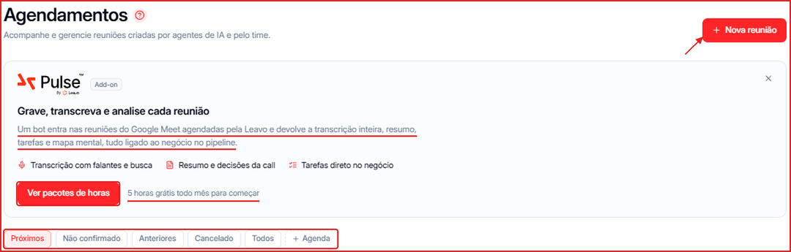
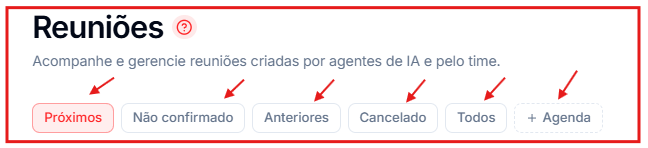
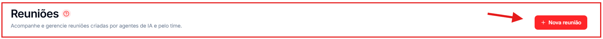
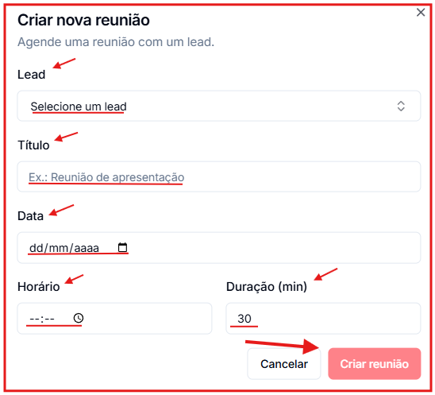

A tela **Agendamentos** centraliza todas as reuniões marcadas na plataforma — tanto as criadas automaticamente pelos agentes de IA quanto as agendadas manualmente pelo time.

**Para acessar:** Menu lateral → Agendamentos

🎥 **Prefere assistir?** Veja o tutorial em vídeo:

<iframe className="w-full aspect-video rounded-xl border border-gray-200 dark:border-gray-800" src="https://www.tella.tv/video/como-usar-a-aba-de-agendamentos-na-leavo-feul/embed" allowFullScreen />

---

## Para que serve?

Sempre que um agente de IA agenda uma reunião com um contato, ela aparece aqui. Se o contato tiver um responsável com agenda conectada, a reunião é marcada na agenda desse responsável, respeitando a duração configurada e sem oferecer horários que já passaram. A equipe também pode criar reuniões manualmente pelo botão **\+ Nova reunião**. É o lugar para acompanhar, confirmar e gerenciar todos os compromissos.

## Abas de organização

A lista de agendamentos é dividida em cinco abas:

- **Próximos** — reuniões futuras já confirmadas.
- **Não confirmado** — reuniões aguardando confirmação.
- **Anteriores** — reuniões que já aconteceram.
- **Cancelado** — reuniões canceladas.
- **Todos** — exibe todos os agendamentos independentemente do status.

## Filtro por agenda

O botão **\+ Agenda** na barra de abas permite filtrar os agendamentos por agenda conectada (ex: Google Agenda). Se nenhuma agenda estiver integrada, aparece apenas a opção "Sem agenda".

<Tip>
  Para ver na Leavo os eventos reais de uma agenda do Google, ative a opção **"Exibir todos os eventos desta agenda"** nas configurações do [Google Agenda](/integracoes/google-agenda).
</Tip>

## Pulse: gravação, transcrição e resumo das reuniões

O **Pulse** é um add-on da Leavo: um bot entra nas reuniões do **Google Meet** agendadas pela Leavo e devolve a transcrição completa (com identificação de quem falou e busca), o resumo com as decisões da call, as tarefas e um mapa mental — tudo ligado ao negócio no Pipeline.

Clique em **Ver pacotes de horas** no banner para contratar. Há **5 horas grátis por mês** para começar.

## Criar um agendamento manualmente

Clique em **\+ Nova reunião** no canto superior direito para abrir o formulário **Criar nova reunião**:

**Contato** _(obrigatório)_ Selecione o contato com quem a reunião será realizada.

**Título** _(obrigatório)_ Dê um nome para a reunião. Exemplo: `Reunião de apresentação`, `Demo do produto`.

**Data** _(obrigatório)_ Escolha a data da reunião no formato dd/mm/aaaa.

**Horário** _(obrigatório)_ Defina o horário de início da reunião.

**Duração (min)** Informe a duração em minutos. O valor padrão é **30 minutos**.

Clique em **Criar reunião** para confirmar. O agendamento aparecerá na aba **Próximos** ou **Não confirmado**, dependendo do status.
