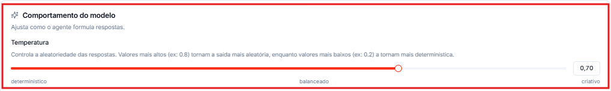
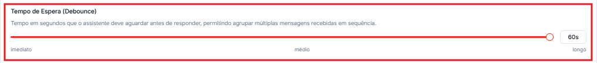
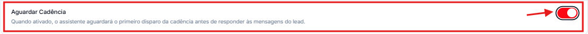
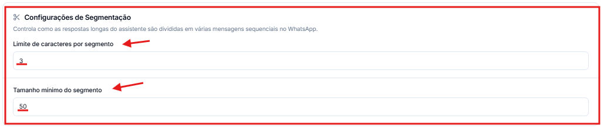
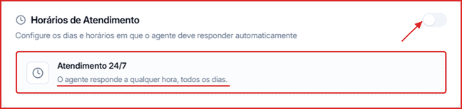
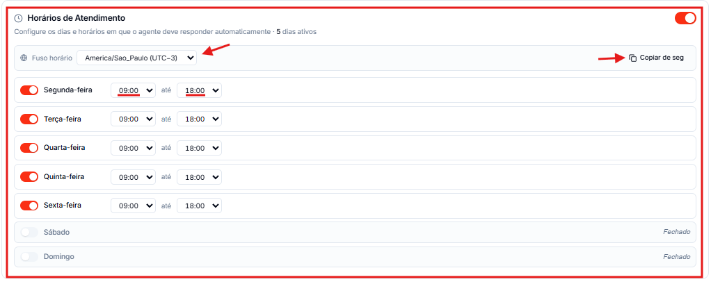
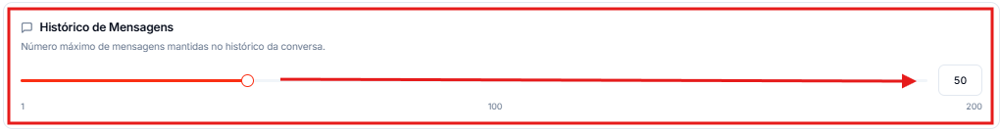
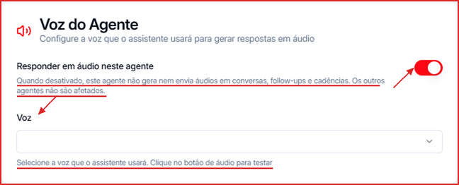

A aba **Configurações** controla o comportamento técnico do agente: resposta, segmentação de mensagens, horários de atendimento, histórico e voz.

**Para acessar:** Agentes → selecione um agente → aba Configurações

🎥 **Prefere assistir?** Veja o tutorial em vídeo:

<iframe className="w-full aspect-video rounded-xl border border-gray-200 dark:border-gray-800" src="https://www.tella.tv/video/aprenda-a-configurar-o-comportamento-temperatura-tempo-de-espera-e-outras-opcoes-do-seu-agente-de-ia-8vhb/embed" allowFullScreen />

---

## Como ajustar a temperatura das respostas

Na seção **Comportamento do Modelo**, mova o slider **Temperatura** entre **determinístico** e **criativo**:

- Valores baixos (próximos a 0,2) — respostas mais previsíveis e consistentes.
- Valores altos (próximos a 0,8) — respostas mais variadas e criativas.

## Como configurar o tempo de espera antes de responder (Debounce)

Mova o slider **Tempo de Espera (Debounce)** para definir quantos segundos o agente aguarda antes de responder. Isso permite agrupar várias mensagens enviadas em sequência pelo contato em uma única resposta — evitando respostas fragmentadas.

## Como fazer o agente aguardar a cadência antes de responder

Ative o toggle **Aguardar Cadência**. Quando ativado, o agente espera o primeiro disparo da cadência antes de responder às mensagens do contato.

## Como configurar a segmentação de mensagens longas

Na seção **Configurações de Segmentação**, ajuste:

- **Limite de caracteres por segmento** — número máximo de caracteres por mensagem no WhatsApp. Respostas longas são divididas automaticamente em partes.
- **Tamanho mínimo do segmento** — número mínimo de caracteres para que um trecho seja enviado como segmento separado.

## Como configurar os horários de atendimento

Com o toggle de **Horários de Atendimento** desligado, o agente funciona em **Atendimento 24/7** — responde a qualquer hora, todos os dias.

Para limitar os horários:

1. Ligue o toggle de **Horários de Atendimento**.
2. Ative cada dia da semana em que o agente deve responder.
3. Para cada dia ativo, defina o **horário de início** e o **horário de término**.
4. Use **Copiar de seg** para replicar o horário da segunda-feira para os outros dias ativos.
5. Ajuste o **fuso horário** se necessário (padrão: `America/Sao_Paulo`).

Fora do intervalo configurado, o agente não responde automaticamente.

<Tip>
  O Dashboard mostra o alerta **Agente sem horário de atendimento** quando um agente está sem horários definidos. Se o agente deve atender 24/7, é só manter o toggle desligado.
</Tip>

As mensagens que chegam fora do expediente aparecem no Dashboard, aba **Atendimento**, em **Fora do horário**.

## Como ajustar o histórico de mensagens

Mova o slider **Histórico de Mensagens** (de 1 a 200) para definir quantas mensagens anteriores da conversa o agente considera ao responder. O padrão recomendado é `50`. Valores mais altos dão mais contexto ao agente, mas deixam as respostas mais lentas.

## Como configurar a voz do agente

Na seção **Integrações → Voz do Agente**:

1. Use o toggle **Responder em áudio neste agente** para ligar ou desligar os áudios **só deste agente**. Desligado, o agente não gera nem envia áudios em conversas, follow-ups e cadências — os outros agentes não são afetados.
2. Em **Voz**, selecione a voz que o agente vai usar. Clique no botão de áudio para ouvir uma prévia antes de salvar.

<Note>
  A ativação da ferramenta de áudio é feita em **Integrações → Ferramentas → ElevenLabs**. Aqui você configura apenas o modelo e a voz para este agente específico. Se nenhuma voz for selecionada, será usada a voz padrão da conta.
</Note>

## Como salvar as alterações

- Clique em **Salvar Alterações** para confirmar manualmente.
- Ou ative **Salvar automaticamente** para salvar em tempo real conforme você edita.
