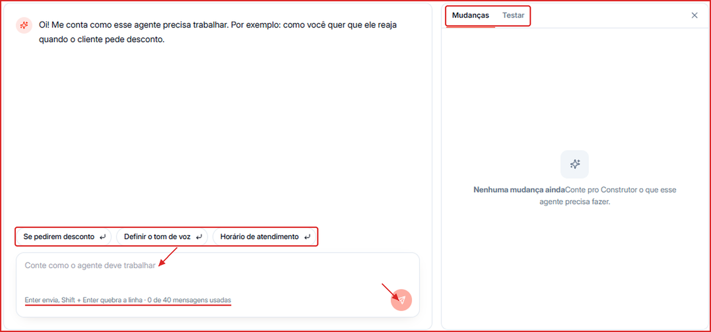

O **Construtor** é a forma mais rápida de ajustar um agente. Em vez de editar campo por campo, você conta em linguagem natural como o agente deve se comportar — e o Construtor transforma isso em mudanças no perfil, nas instruções e nas configurações.

**Para acessar:** Agentes → selecione um agente → aba Construtor

---

## Como usar o Construtor

1. Abra o agente e clique na aba **Construtor**.
2. No campo **Conte como o agente deve trabalhar**, descreva o que você quer. Exemplos:
   - _"Se o cliente pedir desconto, ofereça no máximo 10% e só no plano anual."_
   - _"Use um tom mais descontraído e sempre trate o cliente pelo primeiro nome."_
   - _"Atenda de segunda a sexta, das 8h às 18h."_
3. Se preferir, clique em uma das sugestões prontas (**Se pedirem desconto**, **Definir o tom de voz**, **Horário de atendimento**) para começar.
4. Pressione **Enter** para enviar (use **Shift + Enter** para quebrar linha).
5. Confira no painel **Mudanças**, à direita, o que o Construtor alterou no agente.
6. Abra a aba **Testar** do painel para conversar com o agente e validar o resultado.
7. Clique em **Salvar Alterações** para aplicar.

<Note>
  Cada agente tem um limite de mensagens no Construtor (ex.: **0 de 40 mensagens usadas**). O contador aparece logo abaixo do campo de texto.
</Note>

---

## Dicas para bons resultados

- Peça uma coisa por vez — fica mais fácil revisar cada mudança.
- Seja específico: valores, prazos, horários e exemplos de frases ajudam muito.
- Depois de cada ajuste, teste uma conversa real na aba **Testar**.
- Para conferir ou refinar manualmente o que foi alterado, use as abas [Perfil](/agentes/perfil), [Treinamento](/agentes/treinamento) e [Configurações](/agentes/configuracoes).
