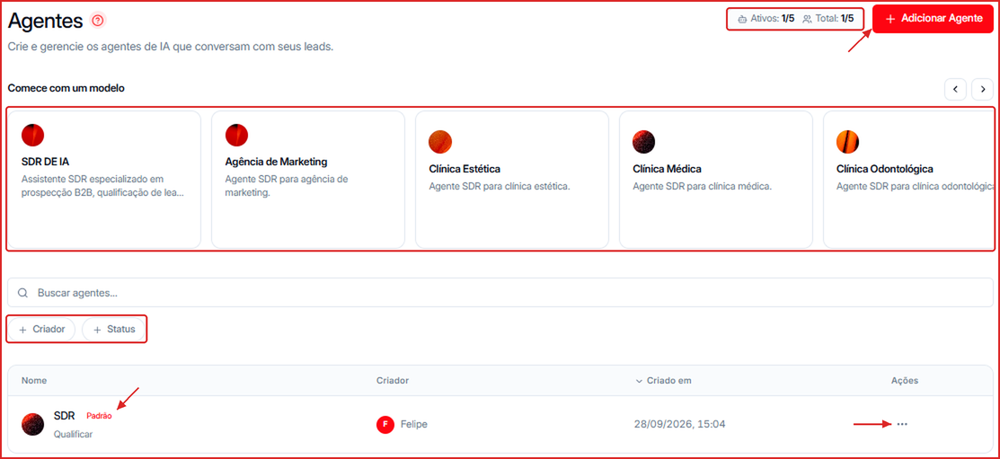
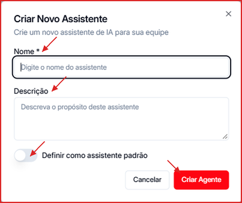
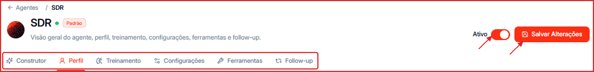
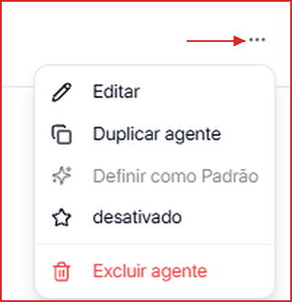

Na tela **Agentes** você vê todos os agentes de IA da conta e tem as ações para criar, editar, ativar, duplicar e excluir.

**Para acessar:** Menu lateral → Agentes

---

## Como criar um agente a partir de um modelo

Na faixa **Comece com um modelo**, escolha um modelo pronto (ex.: **SDR de IA**, **Agência de Marketing**, **Clínica Estética**, **Clínica Médica**, **Clínica Odontológica**). Use as setas à direita para ver mais modelos. O agente é criado já com perfil e instruções do segmento — depois é só ajustar.

Para começar do zero:

1. Clique em **\+ Adicionar Agente**.
2. Preencha o **Nome** do agente e, se quiser, uma **Descrição** do propósito dele.
3. Ligue **Definir como assistente padrão** se ele deve ser o agente padrão da conta.
4. Clique em **Criar Agente**. Em seguida, configure-o pelo [Construtor](/agentes/construtor) ou pelas abas.

---

## Como editar um agente

1. Clique no nome do agente na lista, ou no ícone `...` → **Editar**.
2. Navegue pelas abas **Construtor**, **Perfil**, **Treinamento**, **Configurações**, **Ferramentas** e **Follow-up**.
3. Clique em **Salvar Alterações**.

<Tip>
  Quer ajustar o agente conversando, sem mexer campo por campo? Use a aba [Construtor](/agentes/construtor).
</Tip>

---

## Ações do menu `...`

| Ação | O que faz |
| --- | --- |
| **Editar** | Abre as abas de configuração do agente |
| **Duplicar agente** | Cria uma cópia do agente, que você pode ajustar antes de ativar |
| **Definir como Padrão** | O agente padrão (badge **Padrão**) é usado quando nenhum agente específico está vinculado ao contato ou ao canal |
| **Ativar / Desativar** | Liga ou pausa o agente sem excluí-lo. Um agente desativado não responde a novas conversas |
| **Excluir agente** | Remove o agente permanentemente |

<Warning>
  A exclusão é permanente e não pode ser desfeita.
</Warning>

---

## Como filtrar e buscar agentes

- Use **Buscar agentes...** para localizar pelo nome.
- Clique em **\+ Criador** para filtrar por quem criou o agente.
- Clique em **\+ Status** para ver só os ativos ou só os desativados.

---

## Limite de agentes do plano

O contador no topo mostra **Ativos: X/Y · Total: X/Y**, ou seja, quantos agentes estão ligados e quantos existem em relação ao limite do seu plano. Para aumentar o limite, veja [Créditos & Plano](/creditos/adicionais-e-slots).
