**Para acessar:** Cadências → **\+ Nova Cadência** → **Cadência em branco**

Ao clicar em **\+ Nova Cadência**, a Leavo mostra os modelos mais usados. Clique em **Cadência em branco** para começar do zero (ou em **Ver mais modelos** para explorar todos os modelos prontos).

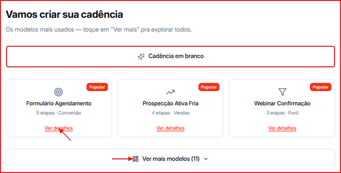

A criação de uma cadência em branco é guiada por um assistente de 8 etapas. Navegue entre elas com os botões **Voltar** e **Continuar** na parte inferior. Algumas etapas possuem o botão **Pular**, que permite avançar sem preencher os campos opcionais.

🎥 **Prefere assistir?** Veja o tutorial em vídeo:

<iframe className="w-full aspect-video rounded-xl border border-gray-200 dark:border-gray-800" src="https://www.tella.tv/video/como-criar-uma-cadencia-em-branco-5qb7/embed" allowFullScreen />

---

## Etapa 1 — Identificação

Defina o nome e a descrição da cadência.

- **Nome da cadência** _(obrigatório)_ — nome interno, só você e seu time veem. Máximo de 100 caracteres.
- **Descrição** _(opcional)_ — texto de referência para a equipe. Máximo de 500 caracteres.

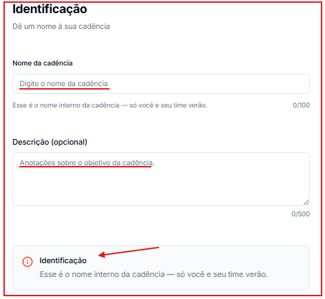

Clique em **Continuar** para avançar.

## Etapa 2 — Agente

Selecione o agente de IA que responderá aos contatos durante a cadência.

- **Agente vinculado** — clique no agente desejado. Ele precisa estar **ativo**.
- **Permitir respostas automáticas (IA)** — ligado por padrão:
  - **Ligado** — quando o contato responder, o agente passa a responder automaticamente.
  - **Desligado** — a cadência faz os disparos, mas a sessão do contato é pausada logo em seguida, sem respostas da IA.
- **Marcar como "Sem resultado" ao concluir** — quando ligado, ao enviar a última etapa sem resposta do contato, o status dele muda automaticamente para **Sem resultado**.

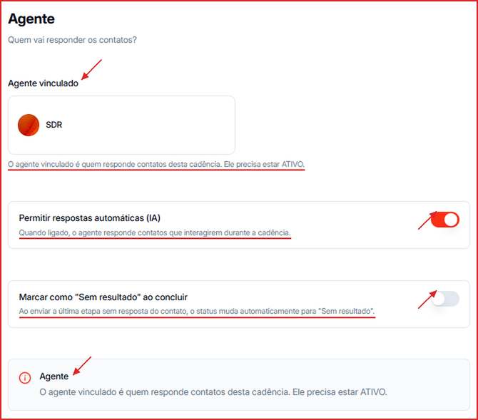

Esta etapa é opcional — clique em **Pular** para continuar sem vincular um agente, ou em **Continuar** após selecionar um.

## Etapa 3 — Critérios de entrada

Define quais contatos podem entrar na cadência.

- **Tags obrigatórias** — o contato precisa ter **exatamente** o conjunto de tags selecionado. Se tiver qualquer tag a mais, ele não entra.
- **Status aceitos** — o contato precisa estar em um dos status selecionados (ex.: Backlog, Reunião agendada, Sem resultado).
- **Etapas do funil** — o contato precisa ter um negócio em uma das etapas de Pipeline selecionadas. A regra vale só na entrada: quem já está na cadência continua mesmo se o negócio mudar de etapa.
- Um contador mostra em tempo real quantos contatos atendem aos critérios.

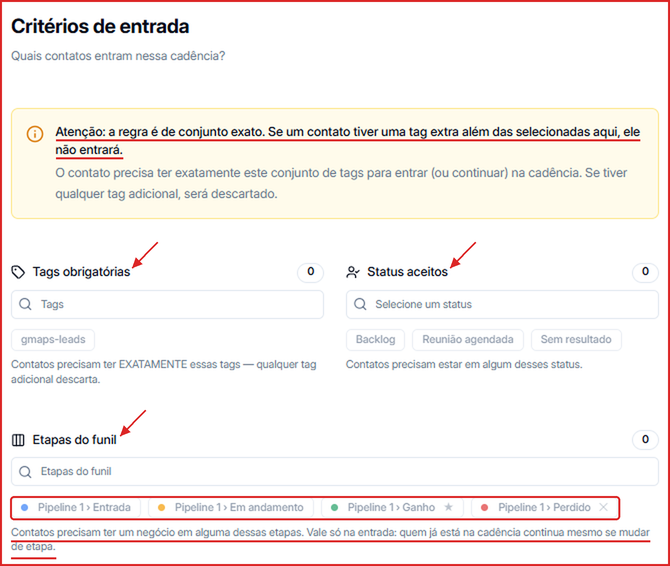

Esta etapa é opcional — clique em **Pular** para aceitar qualquer contato, ou em **Continuar** após configurar os filtros.

---

## Etapa 4 — Mensagens

Configure os passos da cadência e as mensagens de cada passo.

### O que é um passo?

Cada passo é um momento da cadência. O intervalo de cada passo é contado em relação ao passo anterior (ou ao início da cadência, no primeiro passo).

### Configurar um passo

Cada passo exibe:

- **Nome do passo** — nome de referência (padrão: "Passo 1"). Clique para editar.
- **Intervalo** — tempo de espera antes de enviar as mensagens deste passo: Imediatamente (padrão), 1, 2 ou 3 dias, 1 ou 2 semanas, 30 dias, **Antes da reunião** (para lembretes de reunião agendada) ou **Personalizado**.

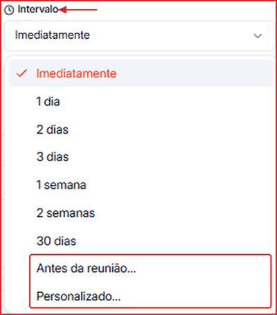

- **Ícone de lixeira** — remove o passo.

### Adicionar mensagens ao passo

Dentro de cada passo, clique em **\+ Adicionar mensagem** para incluir uma nova mensagem. Cada mensagem tem:

- **Tipo** — selecione o formato: Texto, Mídia, Áudio, Template Meta ou Mensagem IA.
- **Atraso (segundos)** — tempo adicional de espera antes de enviar esta mensagem específica (padrão: 0).
- **Conteúdo** — corpo da mensagem. Use o botão **`{x}`** para inserir variáveis dinâmicas.

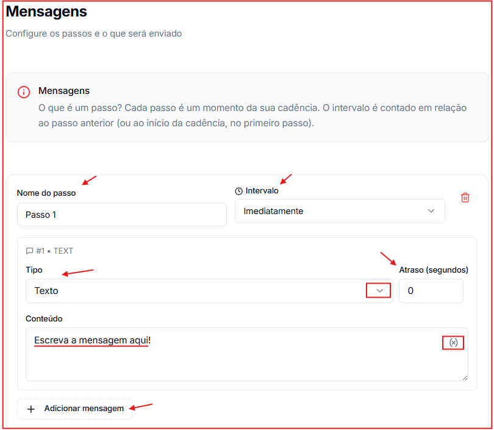

### Adicionar mais passos

Clique em **\+ Adicionar passo** (no final da lista) para incluir um novo passo à cadência.

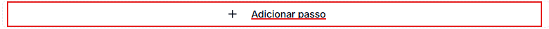

É necessário preencher o conteúdo de pelo menos uma mensagem para avançar. Clique em **Continuar**.

## Etapa 5 — Canais

Selecione por quais canais WhatsApp as mensagens serão enviadas: todos os canais conectados ou apenas canais específicos.

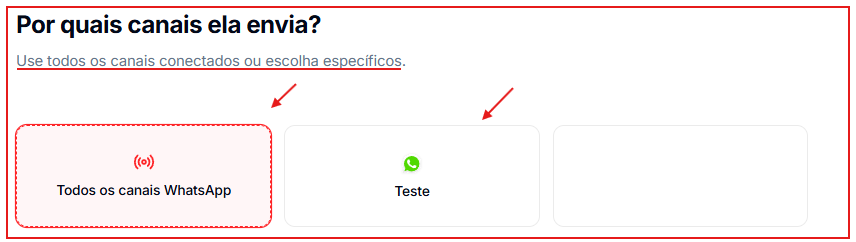

Clique em **Continuar** para avançar.

## Etapa 6 — Janela de envio

Define quando as mensagens serão disparadas.

- **Dias da semana** — selecione os dias ativos. Padrão: segunda a sexta.
- **Horário** — configure o horário de início e término para cada dia ativo. Padrão: 09:00 às 18:00.
- **Fuso horário** — selecione o fuso de referência. Padrão: America/Sao\_Paulo.

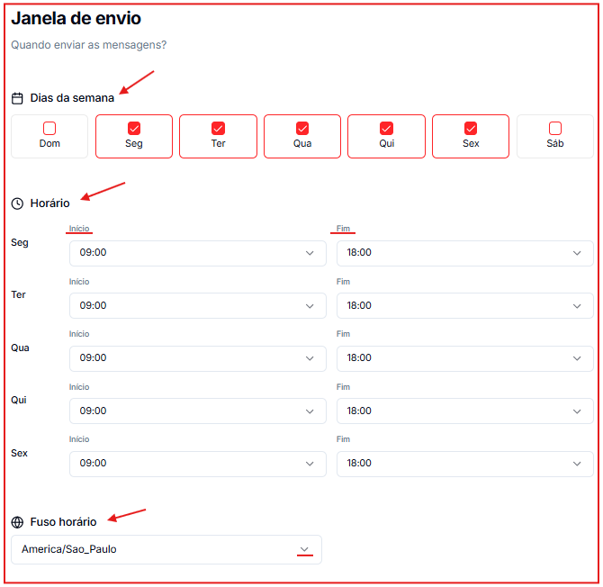

<Note>
  As mensagens só serão disparadas dentro da janela configurada. Feriados não são considerados automaticamente — revise a janela em datas especiais.
</Note>

Clique em **Continuar** para avançar.

## Etapa 7 — Limite de envio

Controla quantos contatos entram na cadência por dia ou hora, evitando volumes altos que possam causar banimento no WhatsApp.

- **Habilitar limite** — toggle ativado por padrão.
- **Tipo** — define a frequência do controle: **Por dia** (padrão) ou **Por hora**.
- **Máximo de contatos** — número máximo de contatos por período (padrão: 20). Use `0` para ilimitado.

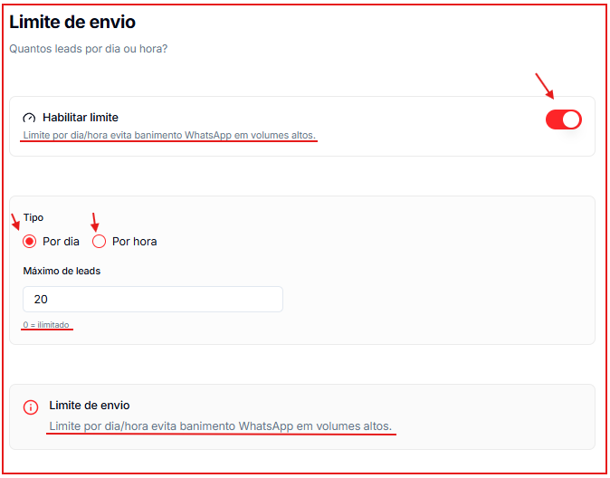

Esta etapa é opcional — clique em **Pular** para não definir limite, ou em **Continuar** após configurar.

## Etapa 8 — Revisão

Exibe um resumo de todas as configurações da cadência antes de finalizar:

- **Identificação** — nome da cadência.
- **Agente** — agente vinculado e status da IA.
- **Critérios de entrada** — tags, status e etapas do funil configurados.
- **Mensagens** — número de passos e total de mensagens.
- **Janela de envio** — fuso horário e dias ativos.
- **Limite de envio** — limite configurado por dia ou hora.

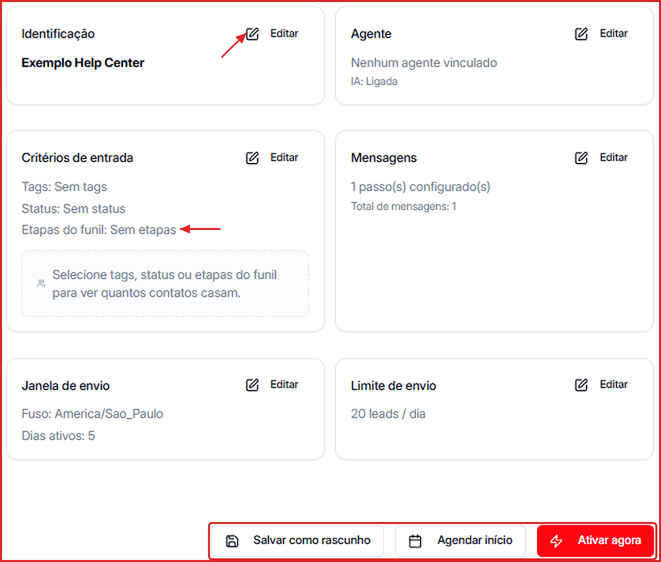

Cada bloco tem um botão **Editar** para voltar diretamente àquela etapa e ajustar as configurações.

### Finalizar a cadência

Ao fim da revisão, escolha uma das opções:

- **Salvar como rascunho** — salva a cadência sem ativá-la. Ela ficará com status Inativa até ser ativada manualmente.
- **Agendar início** — define uma data e hora específicas para a cadência entrar em atividade automaticamente.
- **Ativar agora** — salva e ativa a cadência imediatamente.

<Tip>
  Se você fechar o assistente no meio do caminho, a Leavo pergunta se quer sair — o progresso fica salvo como rascunho para continuar depois.
</Tip>
