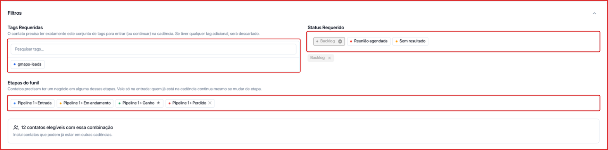
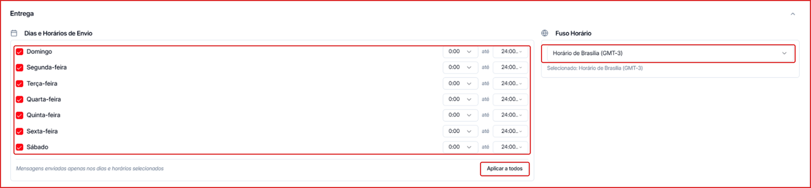
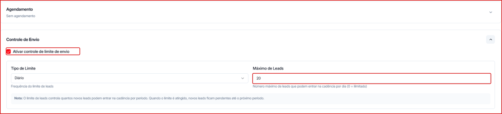
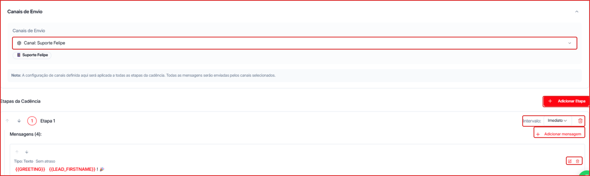

**Para acessar:** Menu lateral → Cadência → clique no nome da cadência → botão **Editar**

<Warning>
  A cadência precisa estar **Inativa** para ser editada. Se estiver ativa, desligue o toggle **Ativa** no topo da página da cadência antes de clicar em **Editar**.
</Warning>

O editor é dividido em seções que abrem e fecham com a seta à direita: **Filtros**, **Agente**, **Entrega**, **Agendamento**, **Controle de Envio**, **Formatação de Variáveis**, **Canais de Envio** e **Etapas da Cadência**. Para renomear a cadência, clique no nome dela no topo.

---

## Como configurar os filtros de entrada

Os filtros definem quais contatos podem entrar (ou continuar) na cadência.

**Tags Requeridas** — busque a tag no campo **Pesquisar tags...** e clique para adicioná-la.

<Note>
  O contato precisa ter **exatamente** o conjunto de tags selecionado. Se tiver qualquer tag adicional, é descartado da cadência.
</Note>

**Status Requerido** — clique nos status desejados. Os selecionados aparecem como chips logo abaixo; clique no **x** para remover.

**Etapas do funil** — escolha as etapas do [Pipeline](/pipeline/gerenciar) em que o contato precisa ter um negócio. Esse filtro vale só na entrada: quem já está na cadência continua mesmo se o negócio mudar de etapa.

Abaixo dos filtros, a Leavo mostra quantos **contatos elegíveis** existem com essa combinação (incluindo contatos que já podem estar em outras cadências).

---

## Como trocar o agente vinculado

1. Abra a seção **Agente** e escolha o agente na lista.
2. Use o toggle **IA responde aos contatos** para definir o comportamento depois do disparo:
   - **Ativado** — quando o contato responde, o agente assume a conversa automaticamente.
   - **Desativado** — a cadência envia as mensagens, mas a sessão do contato é pausada em seguida, sem respostas automáticas.

<Tip>
  Se o agente não tiver follow-up configurado, a página da cadência mostra um aviso. Veja [Follow-up](/agentes/follow-up).
</Tip>

---

## Como configurar dias e horários de envio

1. Na seção **Entrega**, marque os dias da semana em que a cadência pode enviar.
2. Para cada dia marcado, defina o horário de início e de término.
3. Para usar o mesmo horário em todos os dias, ajuste um deles e clique em **Aplicar a todos**.
4. Em **Fuso Horário**, escolha o horário de referência (padrão: Horário de Brasília (GMT-3)).

Mensagens só são enviadas nos dias e horários selecionados.

---

## Como agendar o início dos envios

Abra a seção **Agendamento** e defina a data e a hora de início. Quando não configurado, aparece **Sem agendamento** e os envios começam assim que a cadência for ativada.

---

## Como limitar a quantidade de contatos por período

1. Na seção **Controle de Envio**, marque **Ativar controle de limite de envio**.
2. Escolha o **Tipo de Limite** (ex.: Diário).
3. Defina o **Máximo de Leads** que podem entrar na cadência no período. Use `0` para ilimitado.

Quando o limite é atingido, os novos contatos ficam pendentes até o próximo período.

---

## Como configurar o formato das variáveis

Na seção **Formatação de Variáveis**, ajuste o **Idioma**, o **Formato de Data** (ex.: DD/MM/YYYY) e o **Formato de Hora** (ex.: 24h (14:30)) usados nas variáveis das mensagens.

---

## Como selecionar o canal de envio e montar as etapas

**Canais de Envio** — escolha o canal de WhatsApp. A configuração vale para todas as etapas da cadência.

**Etapas da Cadência** — cada etapa é uma fase da sequência e pode ter uma ou mais mensagens:

1. Clique em **\+ Adicionar Etapa**.
2. Em **Intervalo**, defina o tempo de espera antes da etapa (ex.: **Imediato**, 4 horas, 1 dia).
3. Use as **setas** à esquerda para mudar a ordem da etapa, ou a **lixeira** para excluí-la.
4. Clique em **\+ Adicionar mensagem** para incluir uma mensagem na etapa.
5. Clique no **ícone de edição** da mensagem para definir o **Tipo** (ex.: Texto), o **Atraso** e o conteúdo, ou na **lixeira** para excluí-la.

---

## Como salvar as alterações

- **Salvar automaticamente** — ligue o toggle no canto superior direito para salvar cada alteração na hora.
- **Salvar manualmente** — clique em **Salvar** para confirmar todas as alterações de uma vez.
