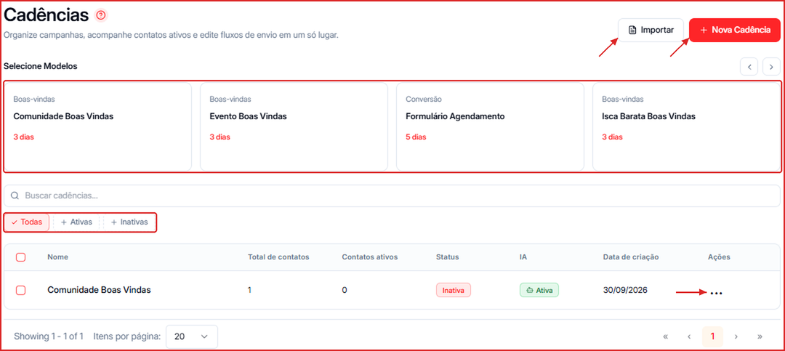

Ações disponíveis na lista de cadências, além da criação e edição — ativação, duplicação, exportação, exclusão, busca e o que cada coluna da tabela significa.

**Para acessar:** Menu lateral → Cadência

---

## Como criar uma cadência a partir de um modelo

Na faixa **Selecione Modelos**, clique em um modelo pronto (ex.: **Comunidade Boas Vindas**, **Evento Boas Vindas**, **Formulário Agendamento**). Cada card mostra a categoria e a duração da cadência em dias. Use as setas para ver mais modelos. O assistente de criação abre já preenchido — é só revisar e ajustar.

Para criar do zero, veja [Criar uma Cadência em Branco](/cadencias/criar-cadencia-em-branco).

---

## Como importar uma cadência

Clique em **Importar** e selecione o arquivo de uma cadência exportada (de outra conta ou de um backup). A cadência importada entra na lista como inativa — revise e ative quando estiver pronta.

---

## Como ativar ou pausar uma cadência

1. Na lista de cadências, localize a cadência desejada.
2. Clique no ícone `...` ao lado dela.
3. Clique em **Ativar** para colocá-la em funcionamento, ou **Desativar** para pausá-la sem excluí-la.

<Note>
  A coluna **Status** na tabela indica o estado atual: **Ativa** ou **Inativa**.
</Note>

---

## Como duplicar uma cadência

1. Clique no ícone `...` ao lado da cadência.
2. Selecione **Duplicar**.

Uma cópia exata da cadência será criada como inativa — edite-a antes de ativar.

---

## Como exportar uma cadência

1. Clique no ícone `...` ao lado da cadência.
2. Selecione **Exportar**.

O arquivo gerado pode ser importado em outra conta ou usado como backup.

---

## Como excluir uma cadência

1. Clique no ícone `...` ao lado da cadência.
2. Selecione **Excluir**.

<Warning>
  A exclusão é permanente e não pode ser desfeita.
</Warning>

---

## Como filtrar e buscar cadências

- Use o campo **Buscar cadências...** para localizar pelo nome.
- Clique nos filtros **Todas**, **Ativas** ou **Inativas** para restringir a lista por status.

---

## O que cada coluna da tabela significa

| Coluna | O que exibe |
| --- | --- |
| Nome | Nome da cadência |
| Total de contatos | Contatos que já entraram na cadência |
| Contatos ativos | Contatos em andamento agora |
| Status | Ativa ou Inativa |
| IA | Se o agente responde automaticamente nesta cadência (Ativa / Pausada) |
| Data de criação | Quando a cadência foi criada |
| Ações | Menu `...` com as ações rápidas |
