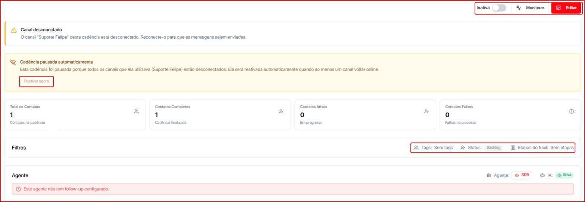
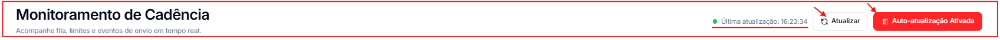
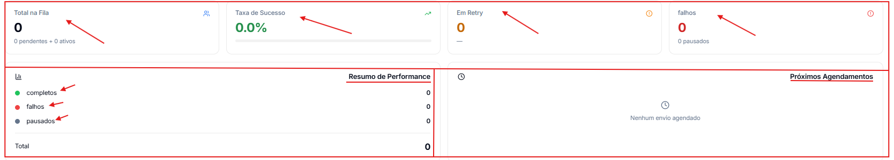
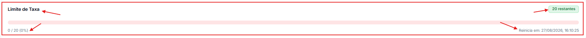
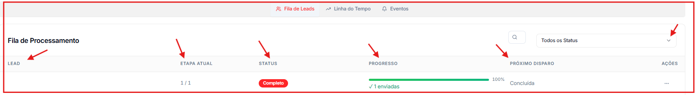
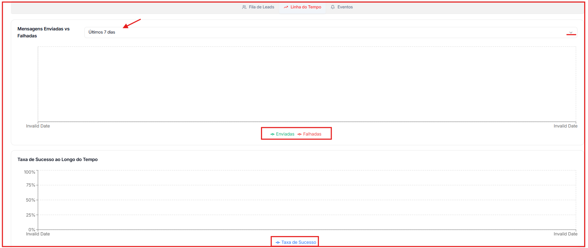
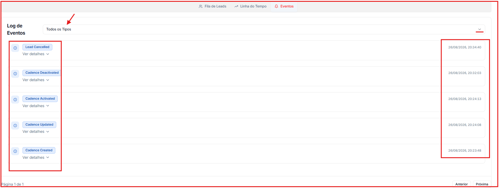

🎥 **Prefere assistir?** Veja o tutorial em vídeo:

<iframe className="w-full aspect-video rounded-xl border border-gray-200 dark:border-gray-800" src="https://www.tella.tv/video/aprenda-a-utilizar-a-aba-de-monitoramento-de-cadencia-3qyr/embed" allowFullScreen />

---

## Visão geral da cadência

**Para acessar:** Menu lateral → Cadência → clique no nome da cadência

- **Inativa / Ativa** — o toggle no topo liga ou pausa a cadência. Ao lado ficam **Monitorar** (painel em tempo real, abaixo) e **Editar**.
- **Alertas** — se o canal da cadência estiver desconectado, aparece **Canal desconectado**. Quando todos os canais da cadência caem, ela fica **pausada automaticamente** e volta sozinha quando um canal reconectar; para retomar antes, clique em **Reativar agora**.
- **Indicadores** — **Total de Contatos**, **Contatos Completos** (cadência finalizada), **Contatos Ativos** (em progresso) e **Contatos Falhos**.
- **Filtros** — mostram quem entra na cadência: **Tags**, **Status** e **Etapas do funil** do Pipeline.
- **Agente** — o agente de IA que responde os contatos da cadência. Se ele não tiver follow-up, aparece o aviso **"Este agente não tem follow-up configurado"** — veja [Follow-up](/agentes/follow-up).
- **Configuração de Entrega** — dias, horários de funcionamento e fuso horário dos envios, seguidos das **etapas** com seus canais, mensagens, atrasos e intervalos.

---

## Monitoramento em tempo real

**Para acessar:** Visão Geral da cadência → botão **Monitorar**

### Como atualizar os dados do painel

- **Atualização automática** — o painel se atualiza sozinho. Clique em **Auto-atualização Ativada** para desligá-la se preferir controle manual.
- **Atualização manual** — clique no botão **Atualizar** a qualquer momento para forçar uma nova leitura.

### Como interpretar os indicadores em tempo real

| Indicador | O que representa |
| --- | --- |
| Total na Fila | Leads aguardando envio (pendentes \+ ativos) |
| Taxa de Sucesso | Percentual de mensagens enviadas com sucesso |
| Em Retry | Leads aguardando nova tentativa de envio |
| Falhos | Leads com falha no envio, incluindo pausados |

O **Resumo de Performance** logo abaixo complementa com o total de leads **Completos**, **Falhos** e **Pausados**.

A seção **Próximos Agendamentos** lista os disparos programados para as próximas horas. Quando não há envios previstos, exibe _"Nenhum envio agendado"_.

### Como acompanhar o consumo do limite de envio

A seção **Limite de Taxa** exibe uma barra de progresso com o uso atual do limite configurado, quantos leads restam no período e quando o limite será reiniciado.

## Como usar as abas de detalhamento

### Fila de Leads

Exibe a lista de leads atualmente na fila da cadência.

- Use o campo de busca para localizar um lead específico.
- Use o filtro **Todos os Status** para segmentar por estado (pendente, ativo, falho etc.).

### Linha do Tempo

Exibe os gráficos de histórico de envio:

1. Clique na aba **Linha do Tempo**.
2. Use o seletor de período (ex.: Últimos 7 dias) para ajustar o intervalo dos gráficos.
3. Analise o volume de **Mensagens Enviadas vs Falhadas** e a **Taxa de Sucesso ao Longo do Tempo**.

### Eventos

Exibe o log cronológico de todas as ações e alterações da cadência (ativação, edição, envios, erros).

- Use o filtro **Todos os Tipos** para segmentar por tipo de evento.

