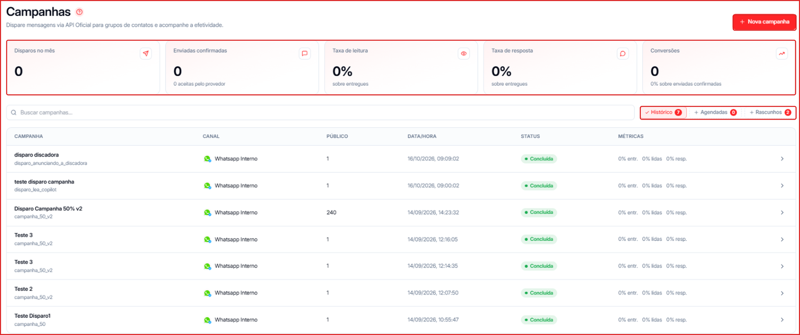
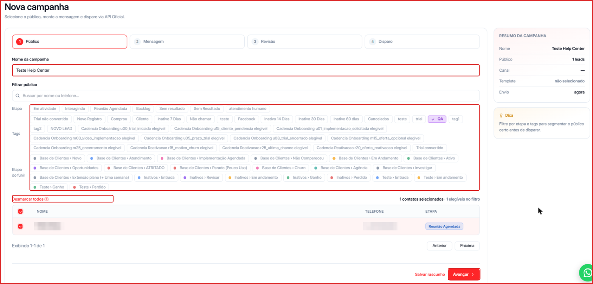
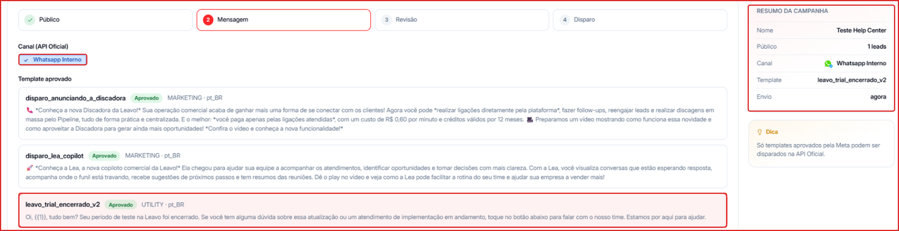
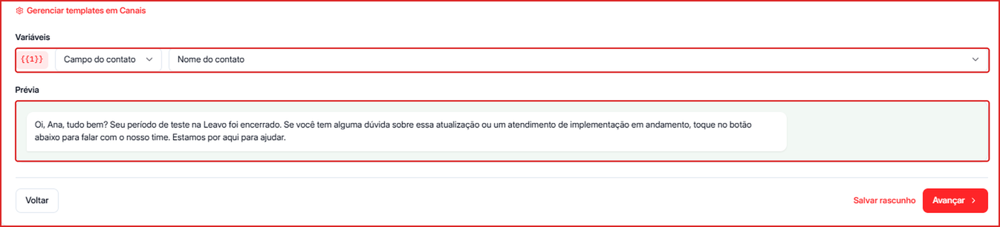
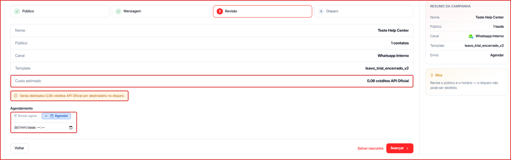
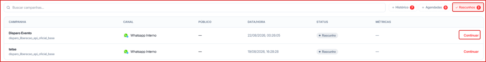

Criar uma campanha envolve 4 etapas guiadas: **Público**, **Mensagem**, **Revisão** e **Disparo**. O **Resumo da Campanha**, no lado direito da tela, é atualizado em tempo real conforme você avança.

<Warning>
  Antes de começar, você precisa de um canal **WhatsApp API Oficial** conectado e de ao menos um **template aprovado pela Meta** nesse canal. Veja [Como criar um Template Oficial da Meta](/canais/criar-template-meta).
</Warning>

---

## Como acessar

**Para acessar:** Menu lateral → Campanhas → botão **\+ Nova campanha** (canto superior direito)

---

## Etapa 1 — Público

Defina o nome da campanha e escolha quem vai receber a mensagem.

1. Preencha o **Nome da campanha** _(obrigatório)_. Use um nome fácil de achar depois, como `Promoção de Julho` ou `Reativação - Inativos 30 dias`.
2. Filtre o público:
   - **Busca** — encontra contatos pelo nome ou telefone.
   - **Etapa** — filtra pelo status do contato (ex.: Em atividade, Interagindo, Sem resultado, Backlog, Reunião agendada).
   - **Tags** — filtra pelas etiquetas aplicadas (ex.: Cliente, Inativo 30 dias, Não chamar).
   - **Etapa do funil** — filtra pela etapa em que o contato está no [Pipeline](/pipeline/visao-geral).
3. Selecione os destinatários:
   - **Selecionar todos (50)** — marca os contatos visíveis na página.
   - **Selecionar todos do filtro (N)** — marca todos os contatos que atendem aos filtros.
   - Ou marque contatos individualmente pelas caixas de seleção.
4. Confira no **Resumo da Campanha** quantos contatos foram selecionados e clique em **Avançar**.

<Tip>
  Combine **Etapa**, **Tags** e **Etapa do funil** para chegar no público certo. Quanto mais preciso o público, melhor o resultado — e menor o custo.
</Tip>

---

## Etapa 2 — Mensagem

Escolha o canal e o template que será enviado.

1. Em **Canal (API Oficial)**, selecione o número que fará o disparo. Só aparecem canais de API Oficial.
2. Escolha um **template aprovado**. Cada template mostra a sua categoria — **UTILITY** (utilidade) ou **MARKETING** — e a categoria influencia o custo do disparo.
3. Confira a **Prévia** da mensagem à direita.

<Warning>
  Se não houver template disponível, clique em **Gerenciar templates em Canais** para criar um e enviar para aprovação. A Meta costuma responder em até 24–48 horas.
</Warning>

### Preencher as variáveis do template

Se o template tiver variáveis (como `{{1}}`), a seção **Variáveis** aparece abaixo da lista. Para cada variável, escolha:

- **Campo do contato** — usa um dado de cada destinatário, como **Nome do contato**. Assim cada pessoa recebe a mensagem personalizada.
- **Texto fixo** — o mesmo texto para todos os destinatários.

Clique em **Avançar** para continuar.

---

## Etapa 3 — Revisão

Confira o resumo antes de disparar:

- Nome da campanha
- Público (quantidade de destinatários)
- Canal e template selecionados
- **Custo estimado** em créditos API Oficial

<Info>
  O custo é calculado **por destinatário** e depende da **categoria do template** (utilidade costuma custar menos que marketing). O valor exato aparece no **Custo estimado** antes do disparo. Veja [Créditos API Oficial](/creditos/creditos-api-oficial).
</Info>

**Agendamento** — escolha quando a campanha sai:

- **Enviar agora** — dispara assim que você confirmar.
- **Agendar** — informe a data e o horário no campo que aparece; o envio acontece automaticamente.

<Warning>
  Depois de disparada, a campanha **não pode ser desfeita**. Revise público, template e variáveis antes de seguir.
</Warning>

Clique em **Avançar** para ir à confirmação.

---

## Etapa 4 — Disparo

Última tela antes do envio. Confira as informações e clique em **Disparar campanha**.

- Se você escolheu **Enviar agora**, a campanha aparece na aba **Histórico**.
- Se você escolheu **Agendar**, ela aparece na aba **Agendadas** até a data do envio.

Para acompanhar entregas, leituras e respostas, veja [Gerenciar Campanhas](/campanhas/gerenciar).

---

## Salvar como rascunho

Em qualquer etapa você pode clicar em **Salvar rascunho** e terminar depois. Para retomar:

1. Na tela de Campanhas, abra a aba **Rascunhos**.
2. Clique em **Continuar** na campanha desejada.

