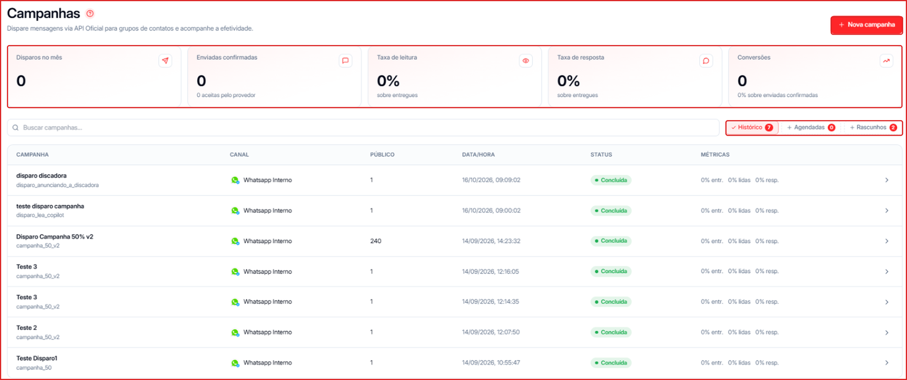
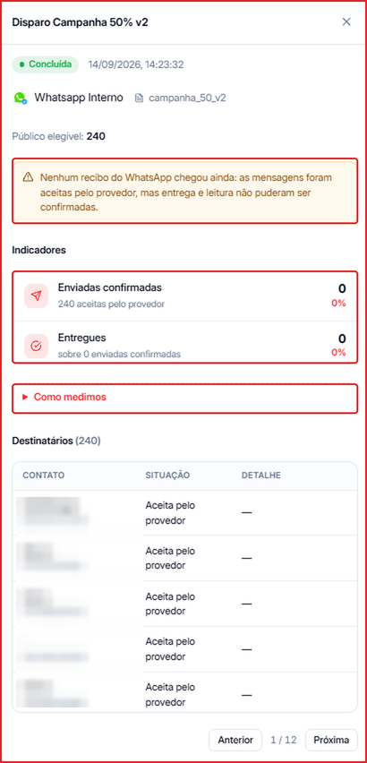
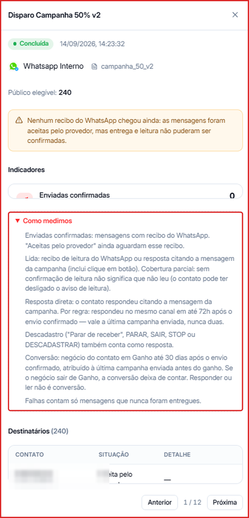
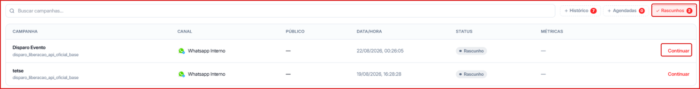

Depois de criar campanhas, é na tela de Campanhas que você acompanha os resultados, abre os detalhes de cada disparo e retoma rascunhos.

**Para acessar:** Menu lateral → Campanhas

---

## Indicadores do mês

O topo da tela mostra os números consolidados do mês:

| Indicador | O que representa |
| --- | --- |
| Disparos no mês | Total de mensagens disparadas no mês corrente |
| Enviadas confirmadas | Mensagens aceitas pelo provedor (Meta) para envio |
| Taxa de leitura | Percentual de mensagens lidas pelos destinatários |
| Taxa de resposta | Percentual de destinatários que responderam |
| Conversões | Destinatários que avançaram após receber a campanha |

---

## Como localizar uma campanha

- Use a busca **Buscar campanhas...** para encontrar pelo nome.
- Alterne entre as abas:
  - **Histórico** — campanhas já disparadas.
  - **Agendadas** — campanhas com envio programado.
  - **Rascunhos** — campanhas salvas e ainda não disparadas.

---

## Ver os detalhes de uma campanha

1. Na aba **Histórico** (ou **Agendadas**), clique na campanha.
2. O painel de detalhes abre com:
   - **Status**, **canal**, **template** e **público elegível**.
   - Indicadores da campanha, como **Enviadas confirmadas** e **Entregues**.
   - A tabela **Destinatários**, com a situação de cada contato (paginada).

<Info>
  Se aparecer um alerta sobre **recibos**, significa que a Meta ainda não confirmou a entrega ou leitura de parte das mensagens. Os números se atualizam conforme as confirmações chegam.
</Info>

### Como medimos

Dentro do painel, a seção **Como medimos** explica cada indicador da campanha — por exemplo, a diferença entre mensagem **enviada confirmada** (aceita pela Meta), **entregue** (chegou ao aparelho) e **lida**.

---

## Retomar um rascunho

1. Abra a aba **Rascunhos**.
2. Clique em **Continuar** na campanha.
3. O assistente reabre na etapa em que você parou. Veja [Como criar uma nova campanha](/campanhas/criar-campanha).

