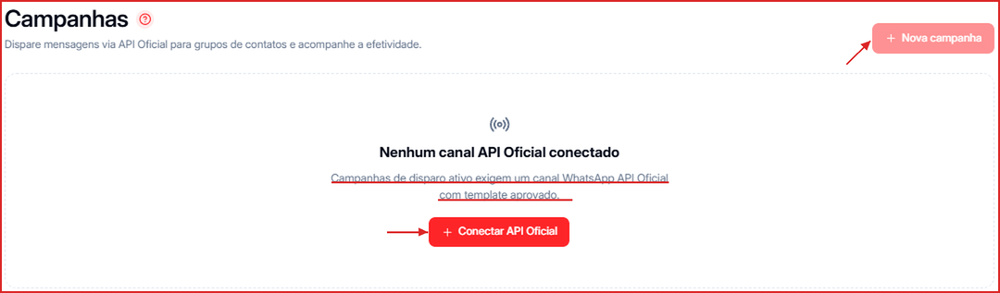

## O que é uma campanha?

Campanhas permitem disparar mensagens em massa para grupos de contatos de forma segmentada e agendada — tudo via **API Oficial do WhatsApp (Meta)** — e acompanhar a efetividade de cada disparo (entregas, leituras, respostas e resultados). É a forma mais eficiente de alcançar um grande volume de contatos com uma mensagem específica, como uma promoção, um aviso ou uma reativação.

**Para acessar:** Menu lateral → Campanhas

<Warning>
  Para criar campanhas, você precisa de um canal **WhatsApp API Oficial** conectado e de um **template aprovado pela Meta**. Enquanto não houver canal da API Oficial, a tela mostra o aviso abaixo e o botão **Conectar API Oficial**, que leva para a tela de Canais.
</Warning>

---

## Onde criar a sua primeira campanha

Você precisa ter ao menos um **template aprovado pela Meta** — veja como criar um em [Como criar um Template Oficial da Meta](/canais/criar-template-meta). Depois, clique em **\+ Nova Campanha** no canto superior direito e defina público, mensagem, revisão e agendamento.

Veja o passo a passo completo em [Como criar uma nova campanha](/campanhas/criar-campanha).

Para acompanhar métricas de desempenho ou localizar campanhas já criadas, veja [Gerenciar Campanhas](/campanhas/gerenciar).
