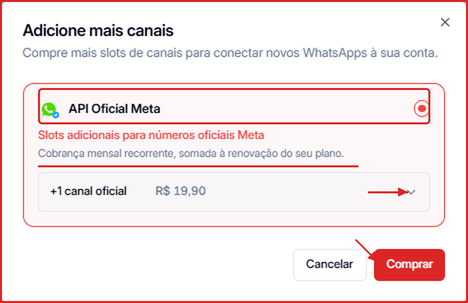

Cada plano da Leavo já inclui um número de canais disponíveis. Se precisar conectar mais números de WhatsApp, é possível comprar slots adicionais diretamente pela plataforma.

---

## Passo a passo

### 1. Acesse a seção de Canais

No menu lateral esquerdo, clique em **Canais**.

---

### 2. Clique em "\+ Comprar mais"

No canto superior direito, ao lado do contador de canais, clique em **\+ Comprar mais**.

---

### 3. Veja as opções de compra

Um modal será exibido com a opção de compra:

**API Oficial Meta** — slots adicionais para números oficiais da Meta

| Quantidade | Valor mensal |
| --- | --- |
| \+1 canal | R\$ 19,90 |
| \+3 canais | R\$ 59,70 |
| \+5 canais | R\$ 99,50 |
| \+10 canais | R\$ 199,00 |

<Note>
  A cobrança é **mensal recorrente**, somada à renovação do seu plano atual.
</Note>

---

### 4. Selecione a quantidade e clique em "Comprar"

Selecione a quantidade no seletor e clique no botão **Comprar** para finalizar.

Após a compra, os novos slots estarão disponíveis imediatamente e você poderá criar novos canais na tela de Canais.
