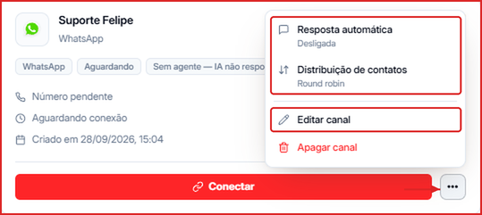
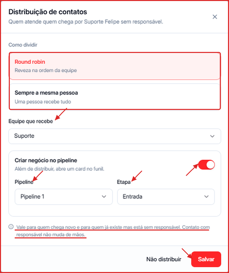
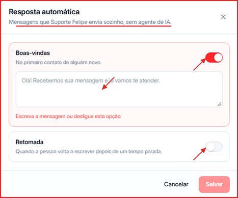
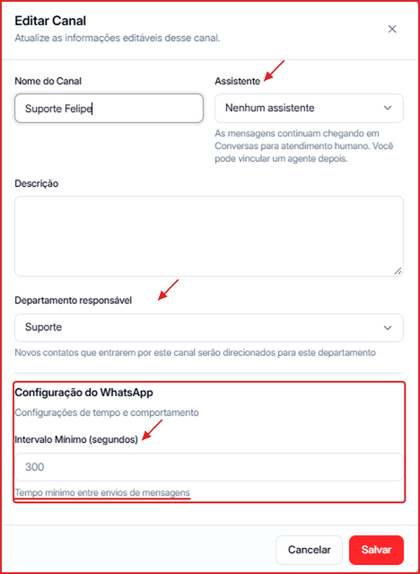

Depois de criar e conectar um canal, você pode definir **quem atende** os contatos que chegam por ele, se a Leavo deve **abrir um negócio no Pipeline** automaticamente e quais **mensagens automáticas** o número envia sem agente de IA.

**Para acessar:** Menu lateral → Canais → ícone `...` no card do canal

O card do canal também mostra, em etiquetas, o tipo, o status da conexão, o agente vinculado (ou **Sem agente — IA não responde**) e a regra de distribuição (ex.: **Round robin**).

---

## Como distribuir os contatos entre o time

A distribuição define quem vira **responsável** pelos contatos que chegam pelo canal sem responsável.

1. No card do canal, clique em `...` → **Distribuição de contatos**.
2. Em **Como dividir**, escolha:
   - **Round robin** — reveza os contatos entre as pessoas da equipe, na ordem.
   - **Sempre a mesma pessoa** — uma pessoa recebe todos os contatos.
3. Em **Equipe que recebe**, escolha o departamento cujos membros vão receber os contatos.
4. Clique em **Salvar**.

<Note>
  A regra vale para quem chega novo e para quem já existe mas está sem responsável. **Contato que já tem responsável não muda de mãos.** Para desligar a distribuição, clique em **Não distribuir**.
</Note>

---

## Como criar negócios no Pipeline automaticamente

Na mesma janela de **Distribuição de contatos**:

1. Ligue o toggle **Criar negócio no pipeline**.
2. Escolha a **Pipeline** e a **Etapa** onde o card deve ser criado (ex.: Pipeline 1 → Entrada).
3. Clique em **Salvar**.

A partir daí, além de distribuir o contato, a Leavo abre um negócio no funil para ele, já com o responsável definido.

<Tip>
  Combine com os [Gatilhos do Pipeline](/pipeline/gerenciar) para mover o negócio de etapa automaticamente quando o status do contato mudar.
</Tip>

---

## Como configurar respostas automáticas (sem agente de IA)

Use quando o canal não tem agente de IA, ou fora do atendimento humano, para que o contato não fique sem resposta.

1. No card do canal, clique em `...` → **Resposta automática**.
2. Ligue as mensagens que quiser e escreva o texto de cada uma:
   - **Boas-vindas** — enviada no primeiro contato de alguém novo.
   - **Retomada** — enviada quando a pessoa volta a escrever depois de um tempo parada.
3. Clique em **Salvar**.

---

## Como editar um canal

1. No card do canal, clique em `...` → **Editar canal**.
2. Ajuste o **Nome do Canal**, o **Assistente** (agente de IA), a **Descrição** e o **Departamento responsável**.
3. Em **Configuração do WhatsApp**, defina o **Intervalo Mínimo (segundos)** — o tempo mínimo entre os envios de mensagens por esse número, para proteger o canal contra bloqueios.
4. Clique em **Salvar**.

---

## Como apagar um canal

No card do canal, clique em `...` → **Apagar canal** e confirme.

<Warning>
  Ao apagar o canal, o número deixa de enviar e receber mensagens pela Leavo e o slot fica livre para outro canal.
</Warning>
