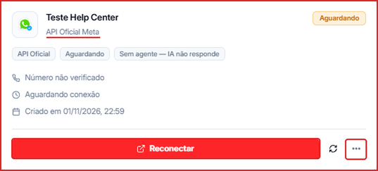
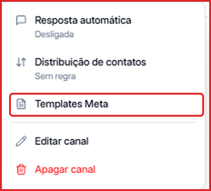
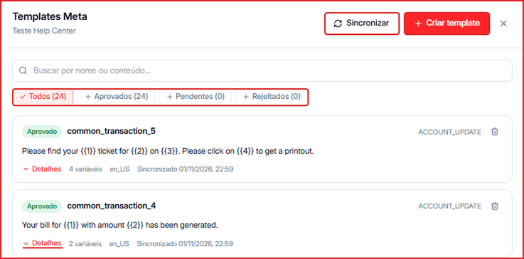
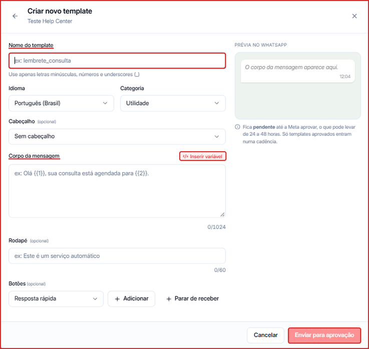

Templates são mensagens pré-aprovadas pela Meta que permitem **iniciar** uma conversa com um contato (fora da janela de 24 horas). Eles são obrigatórios para disparos em **cadências** e **campanhas**.

<Warning>
  Depois de enviado, o template fica **Pendente** até a Meta aprovar, o que pode levar de **24 a 48 horas**. Só templates **Aprovados** entram numa cadência.
</Warning>

---

## Passo a passo

### 1. Abra os Templates Meta do canal

Em **Menu lateral → Canais**, clique nos **três pontinhos (...)** do card do canal.



No menu, clique em **Templates Meta**.



---

### 2. Conheça a janela de templates

A janela **Templates Meta** lista todos os templates do canal:

- **Sincronizar** — busca na Meta os templates e status mais recentes.
- **Criar template** — abre o formulário de novo template.
- **Busca** — encontre um template por nome ou conteúdo.
- **Filtros** — **Todos**, **Aprovados**, **Pendentes** e **Rejeitados**, com a quantidade de cada um.
- Em cada template aparecem o status, a categoria, o texto, o número de variáveis, o idioma e a data da última sincronização. Clique em **Detalhes** para ver o template completo, ou na **lixeira** para excluí-lo.



---

### 3. Clique em "Criar template"

No canto superior direito da janela, clique em **\+ Criar template**.

---

### 4. Preencha o formulário



**Nome do template** _(obrigatório)_ — use apenas letras minúsculas, números e underscores (ex.: `lembrete_consulta`, `boas_vindas`).

**Idioma** — o padrão é **Português (Brasil)**.

**Categoria** — escolha a que melhor descreve o uso:

- **Utilidade** — confirmações, atualizações de pedido, lembretes
- **Marketing** — promoções, ofertas, novidades
- **Autenticação** — códigos de verificação

**Cabeçalho** _(opcional)_ — deixe **Sem cabeçalho** ou adicione um texto, imagem, vídeo ou documento acima da mensagem.

**Corpo da mensagem** _(obrigatório)_ — o texto principal, com até **1024 caracteres**. Clique em **Inserir variável** para adicionar campos personalizados no formato `{{1}}`, `{{2}}`… Exemplo:

```text
Olá {{1}}, sua consulta está agendada para {{2}}.
```

**Rodapé** _(opcional)_ — um texto curto abaixo da mensagem, com até **60 caracteres** (ex.: "Este é um serviço automático").

**Botões** _(opcional)_ — escolha o tipo (ex.: **Resposta rápida**) e clique em **\+ Adicionar**. Use **\+ Parar de receber** para incluir um botão de descadastro.

À direita, a **Prévia no WhatsApp** mostra como a mensagem vai chegar para o contato.

---

### 5. Envie para aprovação

Clique em **Enviar para aprovação**. O template vai para a Meta e aparece no filtro **Pendentes**. Quando aprovado, passa para **Aprovados** e já pode ser usado em cadências e campanhas.

---

## Dúvidas frequentes

<AccordionGroup>
  <Accordion title="Por que meu template foi rejeitado?">
    A Meta pode rejeitar templates que violam as políticas de uso — conteúdo enganoso, proibido ou que não combina com a categoria escolhida. Revise o texto, ajuste e crie um novo template.
  </Accordion>

  <Accordion title="Criei o template na Meta e ele não aparece na Leavo">
    Abra **Templates Meta** e clique em **Sincronizar** para buscar os templates mais recentes da sua conta Meta.
  </Accordion>

  <Accordion title="Posso editar um template aprovado?">
    Não. Depois de aprovado, o template não pode ser alterado — exclua e crie um novo com o texto ajustado.
  </Accordion>
</AccordionGroup>
