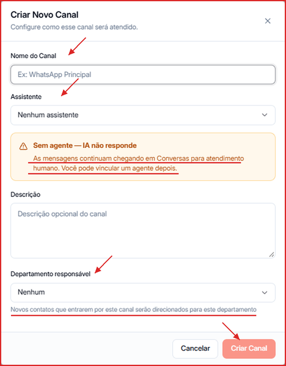
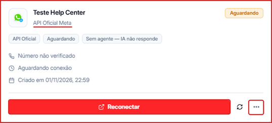

**Para acessar:** Menu lateral → Canais

---

## O que é um canal?

Um canal é o número de WhatsApp pelo qual um agente envia e recebe mensagens dos seus leads. A Leavo conecta os canais pela **WhatsApp Business API (Meta oficial)**, necessária também para campanhas em massa e templates aprovados.

Sem um canal conectado, nenhum agente consegue enviar ou receber mensagens — é o primeiro passo antes de configurar qualquer outra coisa na plataforma.

---

## Onde conectar o seu primeiro canal

1. Acesse **Menu lateral → Canais** e clique em **\+ Novo Canal**.
2. Dê um **Nome do Canal** (ex.: "WhatsApp Principal").
3. Em **Assistente**, escolha o agente de IA que vai atender esse número. Se deixar **Nenhum assistente**, a IA não responde — as mensagens chegam em Conversas para atendimento humano, e você pode vincular um agente depois.
4. Se quiser, preencha uma **Descrição** e escolha o **Departamento responsável** — novos contatos que chegarem por esse canal vão para esse departamento.
5. Clique em **Criar Canal**. O canal é criado direto como **API Oficial Meta**, com status **Aguardando**.

6. No card do canal, clique em **Reconectar** para abrir a conexão com a Meta e concluir o cadastro do número.

Veja o passo a passo completo em [API Oficial — Número Novo](/canais/conectar-api-oficial-numero-novo) ou [API Oficial — Coexistência](/canais/conectar-api-oficial-coexistencia).

Para criar templates aprovados pela Meta ou comprar mais slots de canal, veja [Como criar um Template Oficial da Meta](/canais/criar-template-meta) e [Como comprar mais slots de Canal](/canais/comprar-slots).
