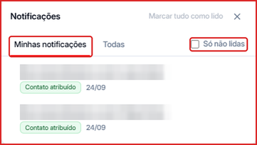

As notificações avisam sobre acontecimentos importantes na sua conta — por exemplo, quando um **novo contato é atribuído a você**.

**Para acessar:** clique no **sino** no topo da tela. Um número no sino indica quantas notificações não foram lidas.

- **Minhas notificações** — só o que é para você (ex.: contatos atribuídos a você).
- **Todas** — todas as notificações da conta.
- **Só não lidas** — esconde as que você já viu.
- **Marcar tudo como lido** — zera o contador do sino.

Cada notificação mostra uma etiqueta com o tipo do aviso (ex.: **Contato atribuído**) e quando ela aconteceu.
