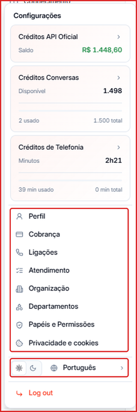
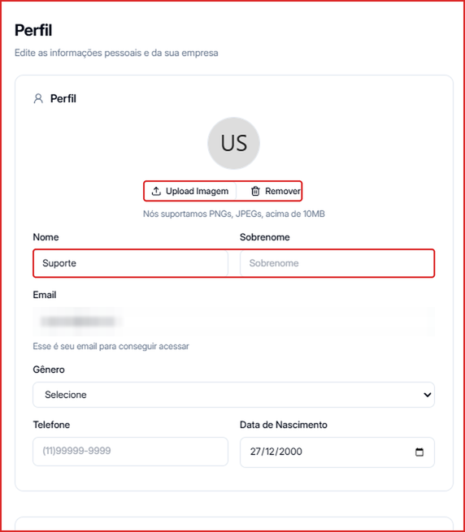
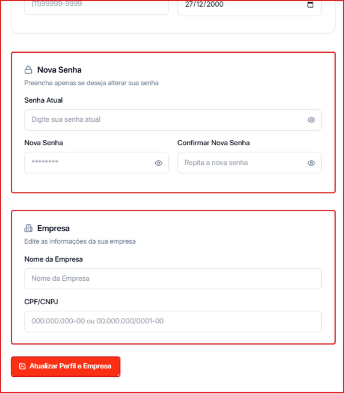

## Menu de configurações

**Para acessar:** clique no seu nome no **canto inferior esquerdo** da tela.

O menu reúne:

- **Cards de saldo** — [Créditos API Oficial](/creditos/creditos-api-oficial), [Créditos Conversas](/creditos/creditos-conversas) e [Créditos de Telefonia](/creditos/creditos-telefonia). Clique em um card para comprar mais.
- **Perfil** — seus dados e os dados da empresa (abaixo).
- **Cobrança** — plano e adicionais. Veja [Cobrança e Adicionais](/creditos/adicionais-e-slots).
- **Ligações** — veja [Configurações de Ligações](/ligacoes/configuracoes).
- **Atendimento**, **Organização**, **Departamentos** e **Papéis e Permissões** — veja [Motivos de atendimento](/organizacao/motivos-de-atendimento), [Membros e convites](/organizacao/membros-e-convites), [Departamentos](/organizacao/departamentos) e [Papéis e permissões](/organizacao/papeis-e-permissoes).
- **Privacidade e cookies** — veja [Privacidade e cookies](/conta/privacidade).
- **Tema** — alterne entre o modo **claro** e **escuro**.
- **Idioma** — escolha o idioma da plataforma (ex.: Português).
- **Sair** — encerra a sua sessão.

---

## Como editar o seu perfil

1. Clique no seu nome no canto inferior esquerdo → **Perfil**.
2. Em **Foto**, clique em **Upload Imagem** para enviar uma foto (PNG ou JPEG) ou em **Remover** para tirá-la.
3. Atualize os seus dados: **Nome**, **Sobrenome**, **Email**, **Gênero**, **Telefone** e **Data de Nascimento**.

4. Para trocar a senha, preencha **Senha Atual**, **Nova Senha** e **Confirmar Nova Senha**.
5. Em **Empresa**, confira o **Nome** da empresa e o **CPF/CNPJ**.
6. Clique em **Atualizar Perfil e Empresa** para salvar.

<Tip>
  Se esqueceu a senha atual, saia da conta e use **Esqueci minha senha** na tela de login.
</Tip>
