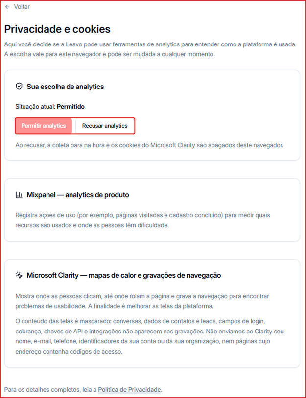

Em **Privacidade e cookies** você decide se a Leavo pode coletar dados de uso da plataforma (analytics) para melhorar o produto.

**Para acessar:** clique no seu nome no canto inferior esquerdo → **Privacidade e cookies**

## Como mudar a sua escolha

1. Em **Sua escolha de analytics**, clique em **Permitir** ou **Recusar**.
2. A escolha vale para **este navegador**. Se você usa a Leavo em outro computador ou navegador, repita lá.

Ao **recusar**, a coleta para e os cookies do Microsoft Clarity são apagados deste navegador.

## Quais ferramentas são usadas

- **Mixpanel** — mede o uso das funcionalidades (ex.: quais telas e botões são usados).
- **Microsoft Clarity** — grava a navegação para entender dificuldades de uso, com o conteúdo das telas mascarado.

Para mais detalhes, veja o link para a **Política de Privacidade** no fim da página.
