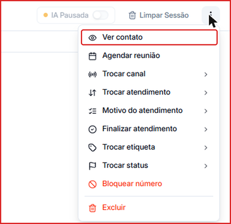
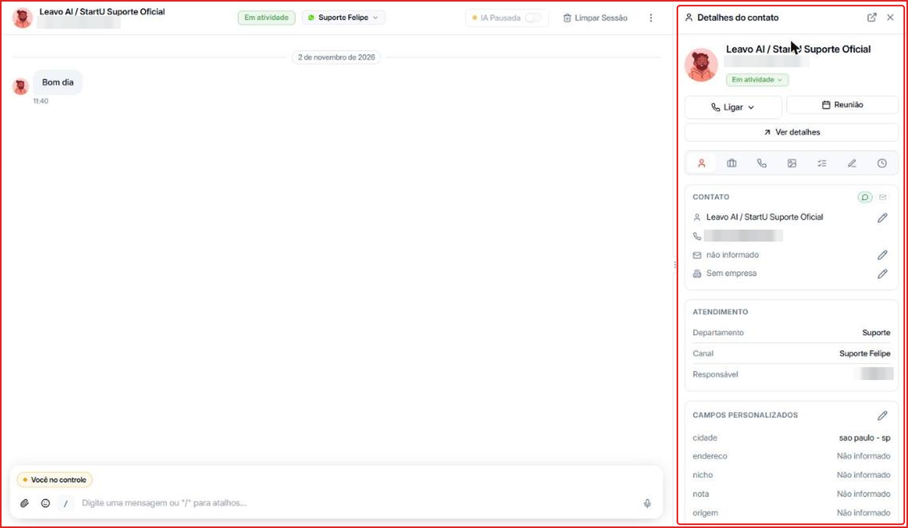
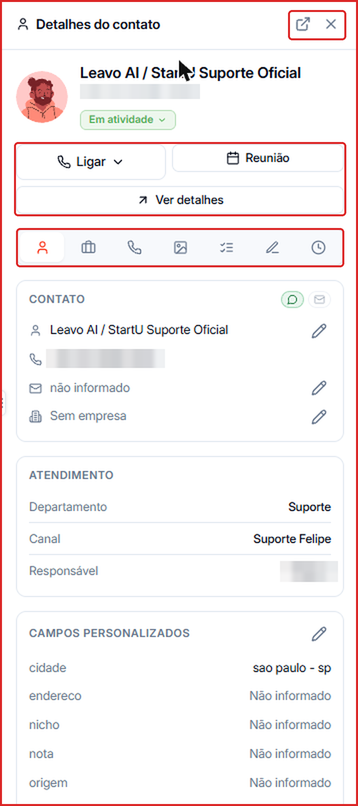
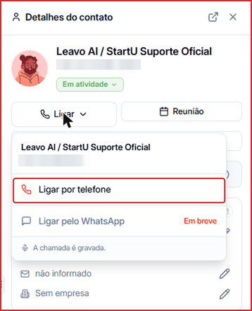
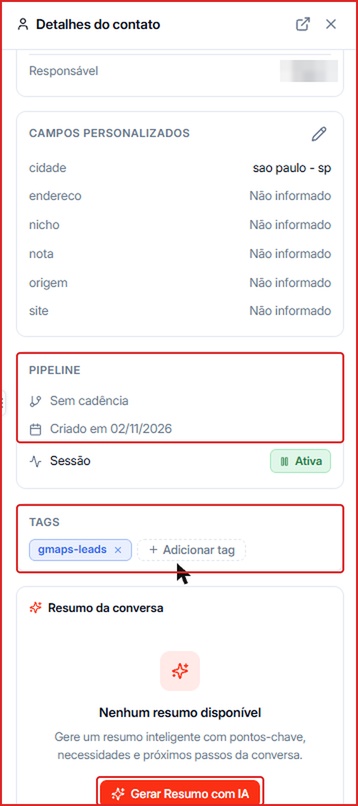
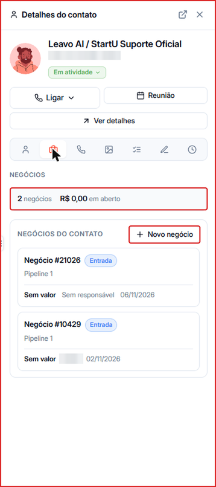
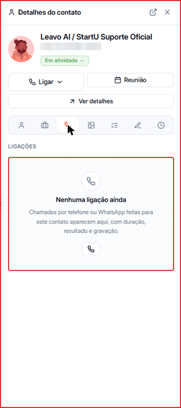
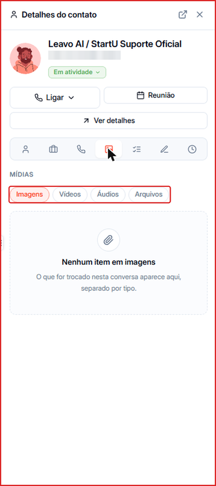
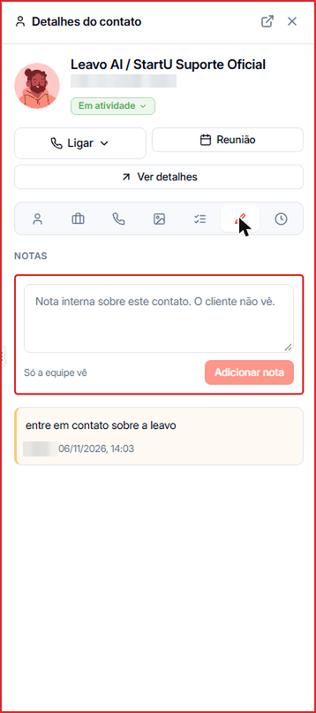
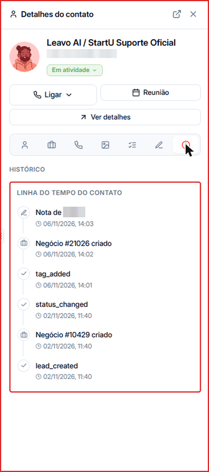

O painel **Detalhes do contato** abre na lateral direita da conversa e reúne tudo sobre o contato — dados, atendimento, negócios, ligações, mídias, notas e histórico — **sem sair da conversa**.

---

## Como abrir o painel

1. Abra uma conversa em **Menu lateral → Conversas**.
2. Clique nos **três pontos (⋮)** no canto superior direito da conversa.
3. Clique em **Ver contato**.

O painel abre à direita, ao lado da conversa:

<Tip>
  Atalho: digite **`/lead`** na barra de mensagens e pressione **Enter** para abrir o painel.
</Tip>

Para fechar, clique no **X** no topo do painel. Para ver o contato em tela cheia, clique no ícone de **abrir página completa** (seta para fora), ao lado do X.

---

## Topo do painel

- **Foto, nome, telefone e status** do contato. Clique no status (ex.: **Em atividade**) para alterá-lo.
- **Ligar** — abre as opções de ligação (veja abaixo).
- **Reunião** — agenda uma reunião com o contato.
- **Ver detalhes** — abre a página completa do contato.
- **Abas** — a barra de ícones troca o conteúdo do painel: **Contato**, **Negócios**, **Ligações**, **Mídias**, **Atividades**, **Notas** e **Histórico**.

### Ligar para o contato

Clique em **Ligar** e escolha **Ligar por telefone**. A chamada é gravada e consome [Créditos de Telefonia](/creditos/creditos-telefonia). **Ligar pelo WhatsApp** aparece como **Em breve**.

Veja mais em [Ligações](/ligacoes).

---

## Aba Contato

É a aba que abre primeiro. Ela traz:

- **Contato** — nome, telefone, e-mail e empresa. Clique no **lápis** ao lado de um campo para editá-lo.
- **Atendimento** — o **Departamento**, o **Canal** e o **Responsável** pela conversa.
- **Campos personalizados** — os campos extras do contato (ex.: cidade, nicho, origem). Clique no **lápis** para preencher ou alterar. Os campos são criados em [Tags, Status e Campos](/leads/gerenciar-tags-status-campos).

Role o painel para baixo para ver:

- **Pipeline** — a cadência em que o contato está (ou **Sem cadência**), a data de criação e se a **Sessão** da IA está **Ativa**.
- **Tags** — as tags do contato. Clique no **x** de uma tag para removê-la ou em **\+ Adicionar tag** para incluir outra.
- **Resumo da conversa** — clique em **Gerar Resumo com IA** para criar um resumo com os pontos-chave, as necessidades do contato e os próximos passos.

---

## Aba Negócios

Mostra quantos negócios o contato tem, o valor **em aberto** e a lista **Negócios do contato**, com o pipeline, a etapa, o valor, o responsável e a data de cada um. Clique em **\+ Novo negócio** para criar um negócio para esse contato.

Veja mais em [Pipeline](/pipeline/criar-negocio).

---

## Aba Ligações

Lista as chamadas feitas para esse contato, com duração, resultado e gravação. Se ainda não houver ligações, aparece **Nenhuma ligação ainda**, com um botão para ligar.

---

## Aba Mídias

Reúne tudo o que foi trocado na conversa, separado em **Imagens**, **Vídeos**, **Áudios** e **Arquivos**. Clique em um tipo para filtrar.

---

## Aba Atividades

Vai reunir as ligações, reuniões e tarefas do contato. Por enquanto aparece como **Atividades em breve**.

---

## Aba Notas

Para registrar observações internas sobre o contato — **o contato não vê, só a equipe**.

1. Escreva a nota no campo **Nota interna sobre este contato**.
2. Clique em **Adicionar nota**.

As notas aparecem abaixo, com o autor, a data e a hora.

---

## Aba Histórico

Mostra a **Linha do tempo do contato**: tudo o que aconteceu com ele, do mais recente para o mais antigo — por exemplo, notas adicionadas, negócios criados, tags aplicadas, mudanças de status e a criação do contato.

