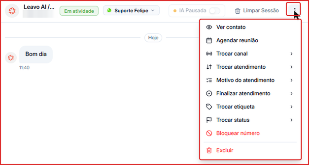
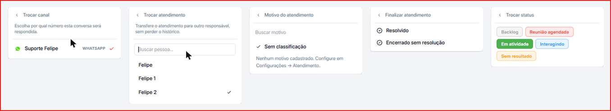
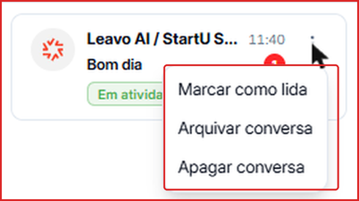
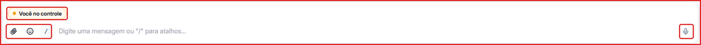
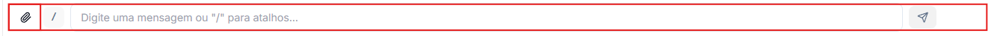
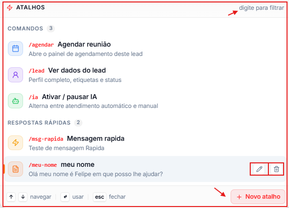

Ao abrir uma conversa, você tem acesso às ferramentas para controlar o atendimento, gerenciar o contato e enviar mensagens. Elas ficam na barra superior e na barra de mensagens, na parte de baixo da conversa.

---

## Barra superior

Na barra superior ficam o nome e o telefone do contato, o **status** atual (ex.: Em atividade), o **canal** pelo qual a conversa está sendo respondida, o controle de **IA**, o botão **Limpar Sessão** e o menu de **três pontos (⋮)**.

### IA Ativa / IA Pausada

O controle de IA define se o agente de IA responde aquele contato automaticamente.

- **IA Ativa** — o agente responde sozinho.
- **IA Pausada** — o agente para de responder e você assume a conversa.

<Tip>
  Pause a IA quando quiser assumir pessoalmente — por exemplo, para fechar uma negociação ou tratar um caso sensível. Você também pode usar o atalho **`/ia`** na barra de mensagens.
</Tip>

### Limpar Sessão

**Limpar Sessão** apaga a memória que a IA tem da conversa atual. Depois disso, o agente recomeça do zero, sem lembrar do que foi dito.

<Warning>
  A memória apagada não pode ser recuperada. As mensagens na tela continuam lá — só a memória do agente é limpa.
</Warning>

### Menu de opções (⋮) da conversa

Clique nos **três pontos** no canto superior direito da conversa para abrir as ações do atendimento:

| Opção | O que faz |
| --- | --- |
| **Ver contato** | Abre o perfil completo do contato, com dados, tags e histórico. |
| **Agendar reunião** | Abre o agendamento para esse contato. |
| **Trocar canal** | Escolhe por qual número (canal) a conversa será respondida. |
| **Trocar atendimento** | Transfere o atendimento para outra pessoa do time, sem perder o histórico. Use a busca para encontrar a pessoa. |
| **Motivo do atendimento** | Classifica a conversa com um motivo (ex.: dúvida, suporte, venda). Os motivos são cadastrados em [Motivos de atendimento](/organizacao/motivos-de-atendimento). Sem motivo, a conversa fica como **Sem classificação**. |
| **Finalizar atendimento** | Encerra o atendimento como **Resolvido** ou **Encerrado sem resolução**. |
| **Trocar etiqueta** | Adiciona ou remove tags do contato. |
| **Trocar status** | Muda o status do contato (ex.: Backlog, Reunião agendada, Em atividade, Interagindo, Sem resultado). |
| **Bloquear número** | Impede que o número envie novas mensagens. Para desbloquear, use a mesma opção. |
| **Excluir** | Exclui a conversa permanentemente. |

As opções com seta (**›**) abrem um submenu. Para voltar ao menu principal, clique na seta **‹** no topo do submenu.

<Tip>
  Use **Finalizar atendimento** junto com **Motivo do atendimento** para que os relatórios mostrem por que os contatos procuraram o time e como cada atendimento terminou.
</Tip>

### Menu de três pontos na lista de conversas

Na lista à esquerda, cada conversa também tem um menu de **três pontos** com ações rápidas, sem precisar abrir a conversa:

- **Marcar como lida** — tira o contador de mensagens não lidas.
- **Arquivar conversa** — tira a conversa da lista principal. Ela continua disponível no filtro **Arquivadas**.
- **Apagar conversa** — exclui a conversa permanentemente.

---

## Barra de mensagens

### 📎 Anexos

Clique no clipe para enviar imagens, vídeos, PDFs, planilhas ou outros arquivos. Você pode selecionar **várias imagens e vídeos de uma vez**, e também colar uma imagem direto no campo de mensagem (Ctrl+V / Cmd+V). Os arquivos recebidos mantêm o nome original.

### 😊 Emojis

Clique no ícone de emoji para abrir o seletor e inserir emojis na mensagem.

### 🎙️ Áudio

Clique no microfone para gravar um áudio e enviá-lo. O áudio chega para o contato como **mensagem de voz** (igual a um áudio gravado no próprio WhatsApp). Nos áudios recebidos, você pode acelerar a reprodução.

### ↩️ Responder uma mensagem específica

Passe o mouse sobre uma mensagem e clique em **Responder** para citá-la. A sua resposta aparece ligada à mensagem original, como no WhatsApp.

### / Atalhos e mensagens rápidas

Clique no ícone **/** (ou digite `/` no campo de texto) para abrir a paleta de atalhos:

| Atalho | Ação |
| --- | --- |
| `/agendar` | Abre o agendamento deste contato |
| `/lead` | Mostra o perfil, as tags e o status do contato |
| `/ia` | Ativa ou pausa o agente de IA nesta conversa |

Clique em **\+ Novo atalho** para criar mensagens rápidas com texto pronto — e, se quiser, com **arquivos anexados** — para situações que se repetem, como saudações, apresentações ou envio de materiais.

---

## Indicador de controle

Quando a IA está pausada e você está respondendo, aparece o aviso **Você no controle** acima da barra de mensagens. Com a IA ativa, o aviso não aparece.
