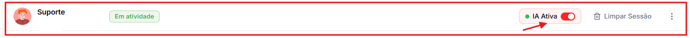
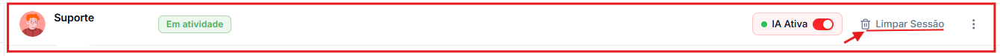
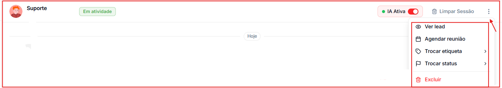
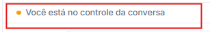

Ao abrir uma conversa, você tem acesso às ferramentas para controlar o atendimento, gerenciar o contato e enviar mensagens. Elas ficam na barra superior e na barra de mensagens, na parte de baixo da conversa.

🎥 **Prefere assistir?** Veja o tutorial em vídeo:

<iframe className="w-full aspect-video rounded-xl border border-gray-200 dark:border-gray-800" src="https://www.tella.tv/video/ferramentas-na-conversa-59xq/embed" allowFullScreen />

---

## Barra superior

### IA Ativa / IA Pausada

O controle de IA, no canto superior direito da conversa, define se o agente de IA responde aquele contato automaticamente.

- **IA Ativa** — o agente responde sozinho.
- **IA Pausada** — o agente para de responder e você assume a conversa.

<Tip>
  Pause a IA quando quiser assumir pessoalmente — por exemplo, para fechar uma negociação ou tratar um caso sensível. Você também pode usar o atalho **`/ia`** na barra de mensagens.
</Tip>

### Limpar Sessão

**Limpar Sessão** apaga a memória que a IA tem da conversa atual. Depois disso, o agente recomeça do zero, sem lembrar do que foi dito.

<Warning>
  A memória apagada não pode ser recuperada. As mensagens na tela continuam lá — só a memória do agente é limpa.
</Warning>

### Menu de opções (⋮)

O ícone de **três pontos** abre ações rápidas para o contato da conversa:

- **Ver contato** — abre o perfil completo, com dados, tags e histórico.
- **Agendar reunião** — abre o agendamento para esse contato.
- **Trocar tag** e **Trocar status** — atualizam o contato sem sair da conversa.
- **Arquivar / finalizar atendimento** — tira a conversa da lista principal. Ela continua disponível no filtro **Arquivadas**.
- **Bloquear número** — impede que o número envie novas mensagens. Para desbloquear, use a mesma opção.
- **Excluir** — exclui a conversa permanentemente.

---

## Barra de mensagens

### 📎 Anexos

Clique no clipe para enviar imagens, vídeos, PDFs, planilhas ou outros arquivos. Você pode selecionar **várias imagens e vídeos de uma vez**, e também colar uma imagem direto no campo de mensagem (Ctrl+V / Cmd+V). Os arquivos recebidos mantêm o nome original.

### 😊 Emojis

Clique no ícone de emoji para abrir o seletor e inserir emojis na mensagem.

### 🎙️ Áudio

Clique no microfone para gravar um áudio e enviá-lo. O áudio chega para o contato como **mensagem de voz** (igual a um áudio gravado no próprio WhatsApp). Nos áudios recebidos, você pode acelerar a reprodução.

### ↩️ Responder uma mensagem específica

Passe o mouse sobre uma mensagem e clique em **Responder** para citá-la. A sua resposta aparece ligada à mensagem original, como no WhatsApp.

### / Atalhos e mensagens rápidas

Clique no ícone **/** (ou digite `/` no campo de texto) para abrir a paleta de atalhos:

| Atalho | Ação |
| --- | --- |
| `/agendar` | Abre o agendamento deste contato |
| `/lead` | Mostra o perfil, as tags e o status do contato |
| `/ia` | Ativa ou pausa o agente de IA nesta conversa |

Clique em **\+ Novo atalho** para criar mensagens rápidas com texto pronto — e, se quiser, com **arquivos anexados** — para situações que se repetem, como saudações, apresentações ou envio de materiais.

---

## Indicador de controle

Quando a IA está pausada e você está respondendo, aparece o aviso **"Você está no controle da conversa"** na parte de baixo. Com a IA ativa, o aviso não aparece.

