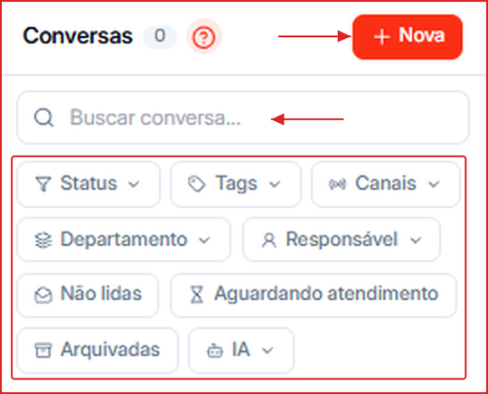
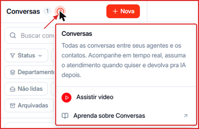
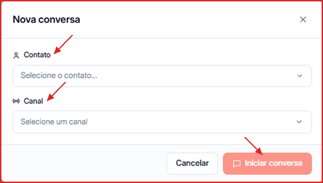
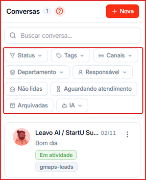
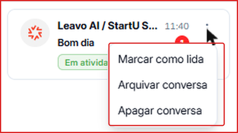

A aba **Conversas** é onde você acompanha e gerencia, em tempo real, todas as conversas de WhatsApp com seus contatos — tanto as atendidas pelos agentes de IA quanto as atendidas pelo seu time.

**Para acessar:** Menu lateral → Conversas

🎥 **Prefere assistir?** Veja o tutorial em vídeo:

<iframe className="w-full aspect-video rounded-xl border border-gray-200 dark:border-gray-800" src="https://www.tella.tv/video/aprenda-a-utilizar-os-filtros-da-aba-de-conversas-2cfy/embed" allowFullScreen />

---

## Ajuda rápida dentro da tela

Clique no ícone **?** ao lado do título **Conversas** para ver um resumo da tela, **Assistir vídeo** ou abrir esta central de ajuda em **Aprenda sobre Conversas**.

---

## Como iniciar uma nova conversa manualmente

1. Clique em **\+ Nova**, no topo da lista de conversas.
2. Em **Contato**, selecione o contato com quem quer falar.
3. Em **Canal**, escolha o número de WhatsApp que vai enviar a mensagem.
4. Clique em **Iniciar conversa**.

<Note>
  Pela API Oficial do WhatsApp, a primeira mensagem para um contato que não falou com você nas últimas 24 horas precisa ser um **template aprovado pela Meta**. Veja [Como criar um Template Oficial da Meta](/canais/criar-template-meta).
</Note>

---

## Como buscar uma conversa

Digite o nome ou o telefone do contato no campo **Buscar conversa...**. A lista é filtrada enquanto você digita, e a busca funciona com ou sem acentos — "joao" encontra "João".

---

## Como filtrar conversas

Clique em qualquer filtro abaixo da busca e selecione o valor desejado. Os filtros com seta (**˅**) abrem uma lista de opções; **Não lidas**, **Aguardando atendimento** e **Arquivadas** ligam e desligam com um clique. Os filtros podem ser combinados.

| Filtro | O que faz |
| --- | --- |
| **Status** | Mostra conversas de contatos em um status específico (ex.: Interagindo, Reunião agendada) |
| **Tags** | Mostra conversas de contatos com determinadas tags |
| **Canais** | Mostra apenas as conversas de um número de WhatsApp |
| **Departamento** | Mostra conversas atribuídas a um departamento |
| **Responsável** | Mostra conversas de um membro específico do time |
| **Não lidas** | Mostra só conversas com mensagens que ainda não foram abertas |
| **Aguardando atendimento** | Mostra contatos que estão esperando a resposta de uma pessoa do time |
| **Arquivadas** | Mostra as conversas finalizadas/arquivadas |
| **IA** | Separa conversas com **IA Ativa** (agente respondendo) e **IA Inativa** (atendimento humano) |

Quando um filtro está aplicado, ele fica destacado com o número de seleções. Para remover, clique nele de novo e desmarque a opção.

<Tip>
  Combine **Aguardando atendimento** + **Responsável** para que cada pessoa do time veja só a própria fila.
</Tip>

---

## O que aparece na lista de conversas

Cada item mostra o nome do contato, a última mensagem enviada ou recebida, o horário, o número de mensagens não lidas, o status atual e as tags do contato. O total de conversas aparece ao lado do título **Conversas**. Clique em uma conversa para abrir o histórico completo e as ferramentas de atendimento — veja [Ferramentas na Conversa](/conversas/ferramentas-na-conversa).

### Ações rápidas na lista

Clique nos **três pontos** de uma conversa na lista para:

- **Marcar como lida** — tira o contador de mensagens não lidas.
- **Arquivar conversa** — tira a conversa da lista principal. Para vê-la de novo, use o filtro **Arquivadas**.
- **Apagar conversa** — exclui a conversa permanentemente.

