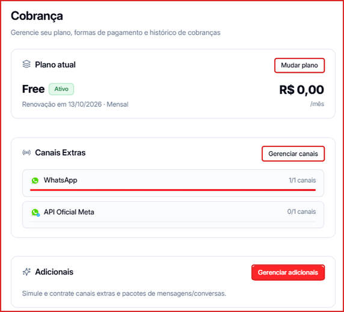
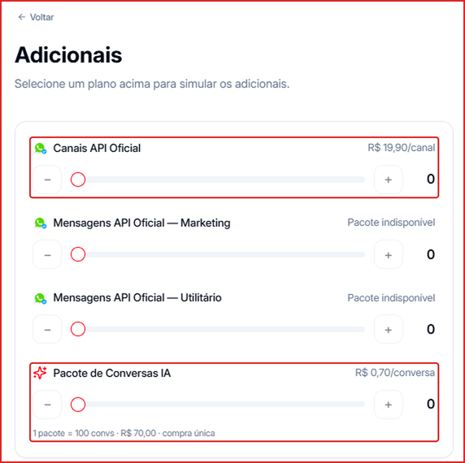

**Para acessar:** clique no seu nome no canto inferior esquerdo → **Cobrança**

---

## O que aparece na Cobrança

- **Plano atual** — o plano contratado, o valor mensal e a data de renovação. Clique em **Mudar plano** para trocar de plano.
- **Canais Extras** — quantos canais você usa em relação ao limite. Clique em **Gerenciar canais** para ajustar.
- **Adicionais** — clique em **Gerenciar adicionais** para simular e contratar canais extras e pacotes.
- Mais abaixo ficam os **Dados de Cobrança** (clique em **Editar** para atualizar), as formas de pagamento e o histórico de cobranças.

---

## O que pode ser contratado

| Adicional | Valor | Cobrança |
| --- | --- | --- |
| **Canais API Oficial** | R\$ 19,90 por canal | Mensal, somada à renovação do plano |
| **Pacote de Conversas IA** | R\$ 0,70 por conversa (1 pacote = 100 conversas = R\$ 70,00) | Compra única, válida por 12 meses |

Os pacotes **Mensagens API Oficial — Marketing** e **Mensagens API Oficial — Utilitário** também aparecem na lista, mas podem estar indisponíveis para o seu plano. Para mensagens da API Oficial, use os [Créditos de API Oficial](/creditos/creditos-api-oficial).

---

## Como contratar

1. Em **Cobrança**, clique em **Gerenciar adicionais**.
2. Use os botões **\+** e **−** (ou arraste o controle) para escolher a quantidade de cada adicional.
3. Confira o **Resumo mensal** com o **Total no mês**.
4. Clique em **Comprar** para confirmar.

<Note>
  Enquanto nenhum adicional estiver selecionado, o botão mostra **Nada a comprar**.
</Note>

---

## Comprar slots direto pela tela de Canais

Você também pode comprar slots de canal em **Canais → + Comprar mais**, sem passar pela Cobrança. [Ver passo a passo →](/canais/comprar-slots)
