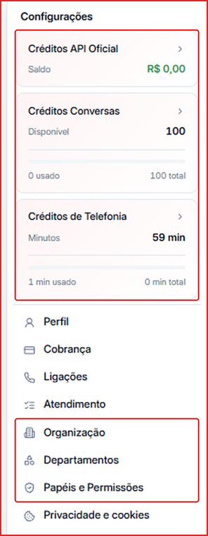
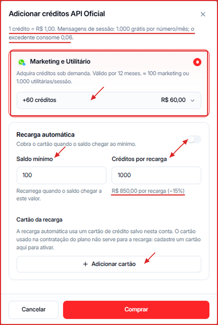
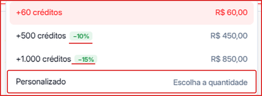

Os **Créditos de API Oficial** pagam as mensagens enviadas pelo WhatsApp API Oficial (Meta) — templates de marketing e utilidade (por exemplo, em campanhas e cadências) e mensagens de sessão acima da franquia gratuita.

---

## Como funciona a cobrança

- **1 crédito = R\$ 1,00.**
- **Mensagens de sessão** (respostas dentro da janela de 24 horas): **1.000 grátis por número, por mês**. Acima disso, cada mensagem consome **0,06 crédito**.
- **Templates de marketing e utilidade** consomem créditos conforme a categoria (como referência, 60 créditos ≈ 100 mensagens de marketing ou 1.000 utilitárias/de sessão).
- Os créditos comprados valem por **12 meses**.

---

## Onde ver o seu saldo

Clique no seu nome, no **canto inferior esquerdo**. O card **Créditos API Oficial** mostra o saldo atual em reais.

---

## Como comprar créditos

1. Clique no seu nome no canto inferior esquerdo.
2. Clique no card **Créditos API Oficial**.
3. Na janela **Adicionar créditos API Oficial**, mantenha selecionado **Marketing e Utilitário**.
4. Escolha a quantidade no seletor.
5. Clique em **Comprar** e conclua o pagamento.

### Pacotes disponíveis

| Créditos | Valor | Desconto |
| --- | --- | --- |
| +60 | R\$ 60,00 | — |
| +500 | R\$ 450,00 | 10% |
| +1.000 | R\$ 850,00 | 15% |
| **Personalizado** | Você escolhe a quantidade | — |

---

## Como ativar a recarga automática

Com a recarga automática, a Leavo compra créditos sozinha quando o saldo fica baixo — assim suas campanhas e cadências não param.

1. Na mesma janela, ligue o toggle **Recarga automática**.
2. Em **Saldo mínimo**, defina o valor que dispara a recarga (ex.: 100).
3. Em **Créditos por recarga**, defina quantos créditos comprar a cada recarga (ex.: 1.000). O valor cobrado e o desconto aparecem logo abaixo.
4. Em **Cartão da recarga**, clique em **Adicionar cartão** e cadastre um cartão de crédito.
5. Clique em **Comprar** para salvar.

<Warning>
  O cartão usado na contratação do plano **não** é usado na recarga automática. É preciso cadastrar um cartão aqui para ativá-la.
</Warning>

---

## Créditos de boas-vindas

Ao contratar um plano, a Leavo libera **R\$ 100 em créditos de API Oficial** — inclusive para quem resgatou o benefício durante o teste grátis.

---

## Para que servem esses créditos?

- Mensagens de **Marketing** (ex.: campanhas promocionais)
- Mensagens **Utilitárias** (ex.: confirmações e lembretes)
- Mensagens de **sessão** acima da franquia de 1.000 por número/mês

Esses créditos são independentes dos **Créditos de Conversas** (IA) e dos **Créditos de Telefonia** (minutos de ligação) — cada um tem seu próprio saldo.
