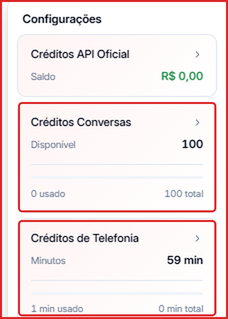
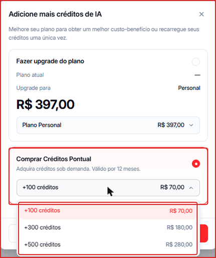

Os **Créditos de Conversas** são consumidos quando um agente de IA da Leavo atende uma conversa com um contato. Cada plano inclui uma quantidade de créditos por mês.

---

## Ver seu saldo atual

Clique no seu nome no **canto inferior esquerdo**. No topo do menu aparecem os cards de créditos; em **Créditos Conversas** você vê o saldo **Disponível**, quanto já foi **usado** no mês e o **total** do seu plano.

---

## Como adicionar créditos

1. No menu do canto inferior esquerdo, clique no card **Créditos Conversas**.
2. Na janela **Adicione mais créditos de IA**, escolha uma das opções:
   - **Fazer upgrade do plano** — mude para um plano com mais créditos mensais incluídos. Escolha o plano na lista e clique em **Upgrade**.
   - **Comprar Créditos Pontual** — compre créditos extras sem mudar de plano. Escolha o pacote na lista e confirme a compra.

### Pacotes de créditos pontuais

| Pacote | Valor |
|--------|-------|
| +100 créditos | R\$ 70,00 |
| +300 créditos | R\$ 180,00 |
| +500 créditos | R\$ 280,00 |

<Note>
  Créditos pontuais são uma **compra única** (não recorrente) e valem por **12 meses**.
</Note>

---

## Adicionar pacotes pela Cobrança

Você também pode comprar o **Pacote de Conversas IA** em **Cobrança → Gerenciar adicionais**, a **R\$ 0,70 por conversa** (1 pacote = 100 conversas = R\$ 70,00), com compra única. Veja [Adicionais e Slots](/creditos/adicionais-e-slots).
