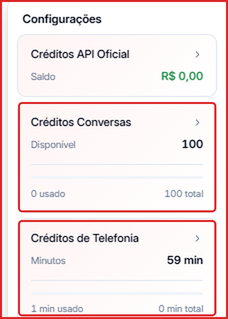
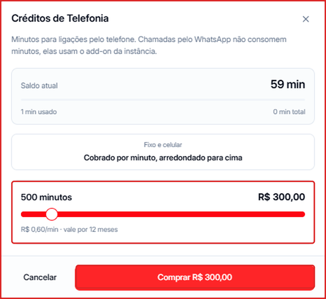

Os **Créditos de Telefonia** são os minutos usados nas [Ligações](/ligacoes) feitas pelo telefone (fixo e celular). Ligações pelo **WhatsApp não consomem minutos** — elas usam o add-on da instância.

---

## Ver seu saldo

Clique no seu nome no **canto inferior esquerdo**. No card **Créditos de Telefonia** aparecem os minutos disponíveis, quanto já foi usado e o total.

---

## Como comprar minutos

1. No menu do canto inferior esquerdo, clique no card **Créditos de Telefonia**.
2. Confira o **Saldo atual** no topo da janela.
3. Arraste o controle para escolher quantos minutos comprar — de **50** a **5.000 minutos**, de 50 em 50. O valor total aparece ao lado.
4. Clique em **Comprar R\$ ...** para confirmar.

---

## Como os minutos são cobrados

| | |
| --- | --- |
| **Preço** | R\$ 0,60 por minuto |
| **Exemplos** | 100 min = R\$ 60,00 · 500 min = R\$ 300,00 · 5.000 min = R\$ 3.000,00 |
| **Arredondamento** | Cobrado por minuto, arredondado para cima |
| **Validade** | 12 meses |

<Note>
  Uma ligação de 1 minuto e 10 segundos consome **2 minutos** de crédito, porque a cobrança é arredondada para cima.
</Note>
