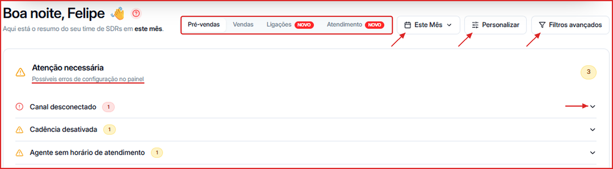
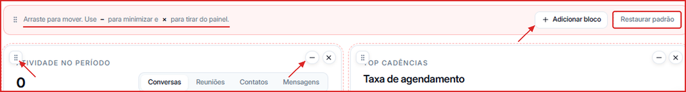

O **Dashboard** é a tela inicial da Leavo. Ele reúne em um só lugar os números do seu time de pré-vendas, vendas, ligações e atendimento, além de alertas de configuração que precisam da sua atenção.

**Para acessar:** Menu lateral → Dashboard

---

## Como alternar entre as visões do Dashboard

No topo da tela, clique em uma das abas:

| Aba | O que mostra |
| --- | --- |
| **Pré-vendas** | Captação e engajamento dos contatos: taxa de resposta, agendamentos, tempo de 1ª resposta, funil Contato → Agendamento, origem dos contatos e performance por agente e por tag |
| **Vendas** | Resultado comercial do Pipeline: negócios ganhos, taxa de conversão, ticket médio, pipeline aberto, ciclo de venda, motivos de perda, funil por etapa, receita por origem e performance por vendedor |
| **Ligações** | Taxa de atendimento, duração média, minutos falados e cobrados, saldo de minutos, melhor hora para ligar, desfecho das ligações e performance por pessoa |
| **Atendimento** | Atendimentos abertos, 1ª resposta humana, tempo de resolução, conversas resolvidas pela IA, fila agora, horário de pico e por quais canais os contatos chegam |

---

## Como ajustar o período analisado

1. Clique no seletor de período (por padrão, **Este Mês**).
2. Escolha o intervalo desejado ou defina um intervalo personalizado.

Todos os cards e gráficos da aba aberta são recalculados para o período escolhido. Os percentuais em verde ou vermelho comparam com o período anterior de mesmo tamanho.

---

## Como filtrar os dados

Clique em **Filtros avançados** para segmentar os números por canal, agente, departamento e outras dimensões.

---

## Como personalizar os blocos do Dashboard

1. Clique em **Personalizar**. O Dashboard entra em modo de edição e o botão passa a se chamar **Concluir**.
2. Arraste um bloco pela alça (⋮⋮) no canto superior esquerdo para mudar a posição.
3. Use **–** para minimizar um bloco ou **×** para tirá-lo do painel.
4. Clique em **Adicionar bloco** para trazer de volta um bloco removido, ou em **Restaurar padrão** para voltar ao layout original.
5. Clique em **Concluir** para salvar.

---

## Como verificar e corrigir problemas de configuração

O painel **Atenção necessária** aparece logo abaixo do cabeçalho quando a Leavo detecta algo que impede a operação de funcionar bem, como **Canal desconectado**, **Cadência desativada** ou **Agente sem horário de atendimento**.

1. Clique na seta à direita do alerta para expandir.
2. Veja quais canais, cadências ou agentes estão afetados.
3. Clique no item para ir direto ao ajuste necessário.

---

## O que cada métrica de Pré-vendas significa

| Métrica | O que representa |
| --- | --- |
| Taxa de Agendamento | Percentual de contatos que chegaram à reunião agendada |
| Agendamentos | Total de reuniões marcadas no período |
| Taxa de Resposta | Percentual de contatos que passaram para **Interagindo** |
| Tempo de 1ª Resposta | Tempo médio até a primeira resposta ao contato |
| Novos Contatos | Contatos captados no período |
| Tempo Contato → Agendamento | Tempo médio entre o primeiro contato e o agendamento |
| Contatos Interagindo | Contatos em conversa ativa |
| Mensagens enviadas | Mensagens enviadas no período |
| Cadências ativas | Cadências em execução agora |

Mais abaixo, a aba Pré-vendas mostra:

- **Atividade no período** — gráfico diário de Conversas, Reuniões, Contatos ou Mensagens, com a linha da média do período.
- **Top Cadências** — ranking das cadências com maior taxa de agendamento.
- **Funil de Vendas** — jornada Contato → Interagindo → Reunião Agendada, com a conversão de cada etapa.
- **Origem dos contatos**, **Performance por agente** e **Performance por tag**.

---

## Conectar a Leavo ao Claude ou ao ChatGPT

No topo do Dashboard aparece o banner **Controle sua operação comercial pela sua IA**. Ele mostra como adicionar o conector da Leavo (`https://mcp.leavo.ai/mcp`) ao Claude ou ao ChatGPT para gerenciar contatos, cadências e campanhas direto pelos seus prompts. Clique em **Assista o vídeo** para ver o passo a passo, ou no **×** para fechar o banner.
