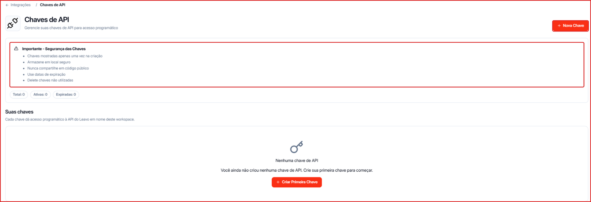
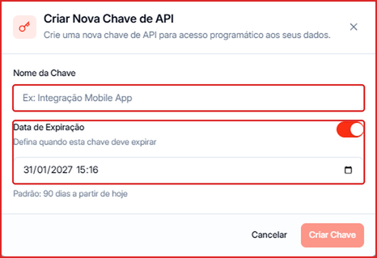
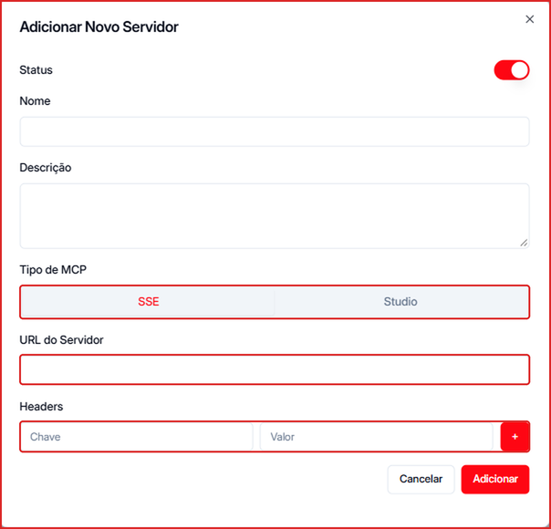

## Leavo API: chaves de acesso

As chaves de API dão acesso programático à Leavo em nome do seu workspace — para integrar sistemas próprios, automações ou um time de desenvolvimento.

**Para acessar:** Menu lateral → Integrações → **Leavo API**

### Como criar uma chave

1. Clique em **\+ Nova Chave** (ou **Criar Primeira Chave**).
2. Dê um **Nome da Chave** que identifique o uso (ex.: "Integração Mobile App").
3. Em **Data de Expiração**, mantenha ligado e escolha quando a chave deve expirar. O padrão é **90 dias** a partir de hoje.
4. Clique em **Criar Chave** e **copie a chave na hora**.

<Warning>
  A chave é mostrada **uma única vez**, na criação. Guarde em local seguro, nunca compartilhe em código público, use datas de expiração e exclua chaves que não usa mais.
</Warning>

No topo da tela você acompanha o total de chaves, quantas estão **Ativas** e quantas **Expiradas**.

---

## Servidores MCP

O **MCP** (Model Context Protocol) conecta servidores externos que ampliam o que os seus agentes de IA conseguem fazer — por exemplo, consultar um sistema interno durante a conversa.

**Para acessar:** Menu lateral → Integrações → **MCP**

### Como adicionar um servidor

1. Clique em **\+ Novo Servidor**.
2. Deixe o **Status** ligado.
3. Preencha o **Nome** e a **Descrição** (ajuda o agente a entender quando usar o servidor).
4. Em **Tipo de MCP**, escolha **SSE** (servidor remoto, acessado por URL) ou **Studio**.
5. Informe a **URL do Servidor**.
6. Se o servidor exigir autenticação, adicione os **Headers** (Chave e Valor) e clique em **\+**.
7. Clique em **Adicionar**.

<Tip>
  Quer o caminho inverso — controlar a Leavo pelo Claude ou pelo ChatGPT? Use o conector MCP da Leavo (`https://mcp.leavo.ai/mcp`). O passo a passo aparece no banner do [Dashboard](/dashboard).
</Tip>
