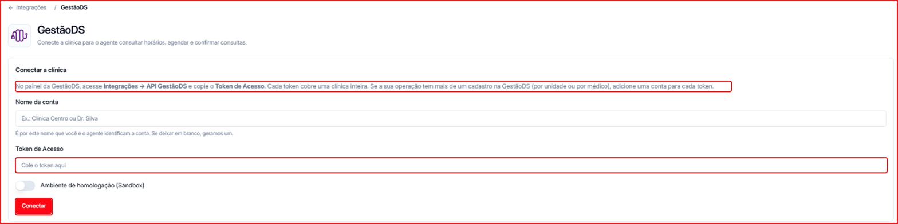
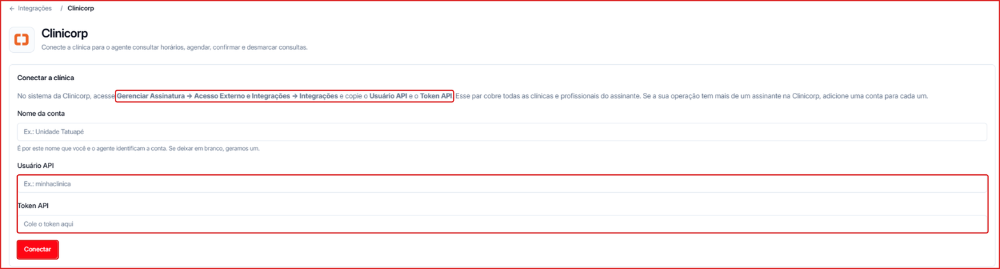

Se a sua clínica usa **GestãoDS** ou **Clinicorp**, conecte o sistema à Leavo para que o agente de IA consulte a agenda real e marque consultas durante a conversa no WhatsApp.

| Sistema | O que o agente faz |
| --- | --- |
| **GestãoDS** | Consulta horários, agenda e confirma consultas |
| **Clinicorp** | Consulta horários, agenda, confirma e desmarca consultas |

---

## Como conectar a GestãoDS

1. No painel da GestãoDS, acesse **Integrações → API GestãoDS** e copie o **Token de Acesso**.
2. Na Leavo, vá em **Menu lateral → Integrações → GestãoDS**.
3. Preencha o **Nome da conta** (ex.: "Clínica Centro" ou "Dr. Silva"). Se deixar em branco, a Leavo gera um nome.
4. Cole o **Token de Acesso**.
5. Ligue **Ambiente de homologação (Sandbox)** só se estiver testando com uma conta de teste da GestãoDS.
6. Clique em **Conectar**.

<Note>
  Cada token cobre uma clínica inteira. Se a sua operação tem mais de um cadastro na GestãoDS (por unidade ou por médico), adicione uma conta para cada token.
</Note>

---

## Como conectar a Clinicorp

1. No sistema da Clinicorp, acesse **Gerenciar Assinatura → Acesso Externo e Integrações → Integrações** e copie o **Usuário API** e o **Token API**.
2. Na Leavo, vá em **Menu lateral → Integrações → Clinicorp**.
3. Preencha o **Nome da conta** (ex.: "Unidade Tatuapé"). Se deixar em branco, a Leavo gera um nome.
4. Cole o **Usuário API** e o **Token API**.
5. Clique em **Conectar**.

<Note>
  O par Usuário API + Token API cobre todas as clínicas e profissionais do assinante. Se a sua operação tem mais de um assinante na Clinicorp, adicione uma conta para cada um.
</Note>

---

## Depois de conectar

O nome da conta é como você e o agente identificam cada clínica. Revise o [prompt do agente](/agentes/construtor) para orientá-lo a oferecer horários e confirmar consultas usando a integração.
