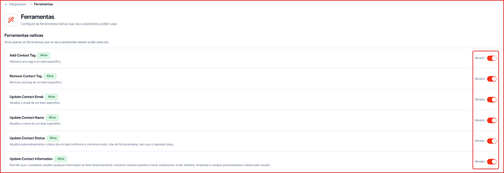
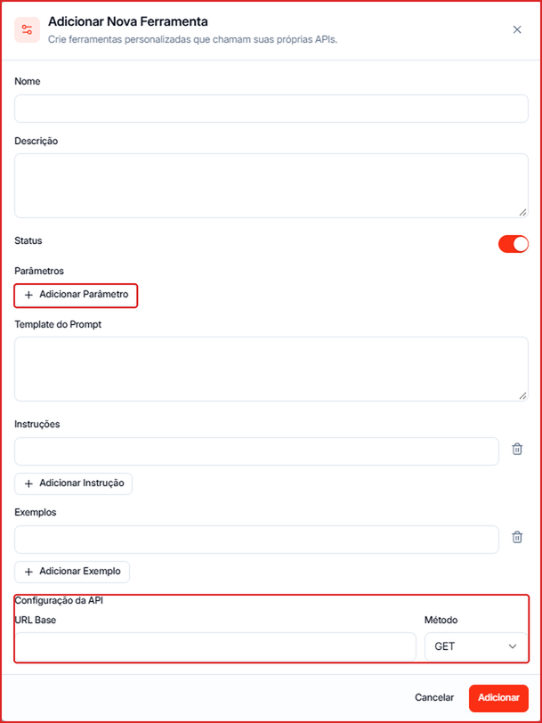

Ferramentas são ações que os agentes de IA podem executar durante uma conversa — como marcar uma tag ou atualizar o status do contato.

---

## Tools: ferramentas nativas

**Para acessar:** Menu lateral → Integrações → **Tools**

Use o toggle de cada ferramenta para liberar ou bloquear a ação para os seus agentes. Ative apenas o que os agentes devem poder fazer.

| Ferramenta | O que o agente faz |
| --- | --- |
| **Add Contact Tag** | Adiciona uma tag ao contato |
| **Remove Contact Tag** | Remove uma tag do contato |
| **Update Contact Email** | Atualiza o e-mail do contato |
| **Update Contact Name** | Atualiza o nome do contato |
| **Update Contact Status** | Atualiza o status do contato conforme a conversa evolui, sem precisar que alguém peça |
| **Update Contact Information** | Atualiza qualquer informação do contato, incluindo campos padrão (nome, sobrenome, e-mail, telefone, empresa) e campos personalizados |

<Tip>
  Com **Update Contact Status** ativa, o agente move o contato de status sozinho — e isso pode disparar os [gatilhos do Pipeline](/pipeline/gerenciar) e entrar em [cadências](/cadencias/visao-geral) que filtram por status.
</Tip>

---

## Custom Tools: ferramentas personalizadas

Crie ferramentas que chamam as **suas próprias APIs** — por exemplo, consultar estoque, gerar um boleto ou buscar um pedido. Cada ferramenta expõe um endpoint HTTP que o agente pode chamar.

**Para acessar:** Menu lateral → Integrações → **Custom Tools**

### Como criar uma ferramenta

1. Clique em **\+ Nova Ferramenta**.
2. Preencha:
   - **Nome** e **Descrição** — explique com clareza o que a ferramenta faz e quando o agente deve usá-la.
   - **Status** — ligado para a ferramenta ficar disponível.
   - **Parâmetros** — clique em **\+ Adicionar Parâmetro** para cada informação que o agente precisa enviar (ex.: CPF, número do pedido).
   - **Template do Prompt** — como o agente deve apresentar o resultado.
   - **Instruções** e **Exemplos** — orientações e exemplos de uso para o agente.
3. Em **Configuração da API**, informe a **URL Base**, o **Método** (GET, POST etc.) e, se precisar, os **Headers** de autenticação.
4. Clique em **Adicionar**.

