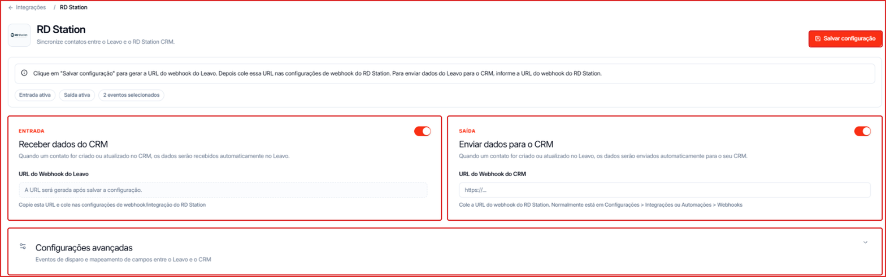

A integração com o **RD Station CRM** sincroniza contatos nos dois sentidos:

- **Entrada** — quando um contato é criado ou atualizado no RD Station, ele chega automaticamente na Leavo.
- **Saída** — quando um contato é criado ou atualizado na Leavo, ele é enviado para o RD Station.

**Para acessar:** Menu lateral → Integrações → **RD Station**

---

## Passo a passo

### 1. Receber contatos do RD Station (Entrada)

1. Deixe o toggle **Entrada** ligado.
2. Clique em **Salvar configuração** para gerar a **URL do Webhook do Leavo**.
3. Copie essa URL e cole nas configurações de webhook/integração do RD Station.

### 2. Enviar contatos para o RD Station (Saída)

1. Deixe o toggle **Saída** ligado.
2. Em **URL do Webhook do CRM**, cole a URL do webhook do RD Station (normalmente em **Configurações → Integrações** ou **Automações → Webhooks**, no RD Station).

### 3. Ajuste os eventos e campos (opcional)

Abra **Configurações avançadas** para:

- Escolher os **eventos que disparam o envio**: **Contato criado** e **Status alterado**.
- Definir o mapeamento **Leavo → RD Station** (quais campos da Leavo vão para quais campos do CRM).
- Definir o mapeamento **RD Station → Leavo** (quais campos do CRM preenchem quais campos da Leavo).

Clique em **\+ Adicionar campo** para cada par de campos.

### 4. Salve

Clique em **Salvar configuração**. No topo da página aparecem as etiquetas com o resumo (ex.: **Entrada ativa**, **Saída ativa**, **2 eventos selecionados**).
