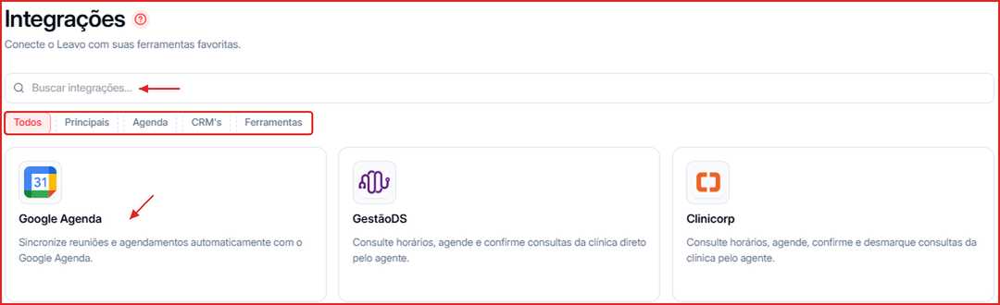

Na tela **Integrações** você conecta a Leavo às ferramentas que já usa — agenda, CRM, sistemas de clínica, webhooks e ferramentas próprias para os agentes.

**Para acessar:** Menu lateral → Integrações

---

## Como encontrar uma integração

1. Use o campo **Buscar integrações...** ou filtre pelas categorias **Principais**, **Agenda**, **CRM's** e **Ferramentas**.
2. Clique no card da integração (ou em **Abrir integração**) para configurar.

---

## Integrações disponíveis

| Integração | Para que serve |
| --- | --- |
| **Google Agenda** | Sincroniza reuniões e agendamentos automaticamente. Veja [Google Agenda](/integracoes/google-agenda). |
| **GestãoDS** | O agente consulta horários, agenda e confirma consultas da clínica. Veja [GestãoDS e Clinicorp](/integracoes/clinicas). |
| **Clinicorp** | O agente consulta horários, agenda, confirma e desmarca consultas da clínica. Veja [GestãoDS e Clinicorp](/integracoes/clinicas). |
| **Webhook** | Entrada (receber contatos de formulários e outros sistemas) e saída (enviar eventos da Leavo, como novo contato, mudança de status, negócio criado/movido e resumo de ligação). Veja [Webhooks](/integracoes/webhooks). |
| **MCP** | Conecta servidores MCP para ampliar o que os agentes conseguem fazer. Veja [Leavo API e MCP](/integracoes/api-e-mcp). |
| **Leavo API** | Gera e gerencia chaves de API para integrações próprias. Veja [Leavo API e MCP](/integracoes/api-e-mcp). |
| **RD Station** | Sincroniza contatos entre a Leavo e o RD Station CRM. Veja [RD Station](/integracoes/rd-station). |
| **Tools** | Liga ou desliga as ferramentas nativas dos agentes. Veja [Tools e Custom Tools](/integracoes/ferramentas-dos-agentes). |
| **Custom Tools** | Cria ferramentas que chamam as suas próprias APIs. Veja [Tools e Custom Tools](/integracoes/ferramentas-dos-agentes). |

<Tip>
  Quer controlar a Leavo pelo Claude ou pelo ChatGPT? Use o conector MCP da Leavo (`https://mcp.leavo.ai/mcp`) — o passo a passo aparece no banner do [Dashboard](/dashboard).
</Tip>
