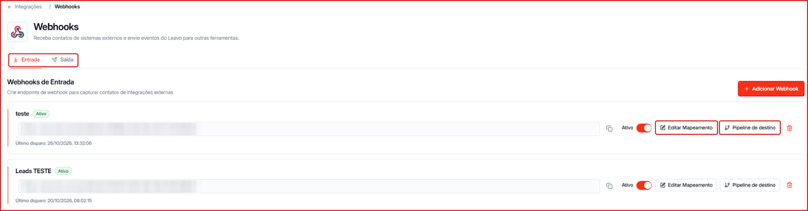
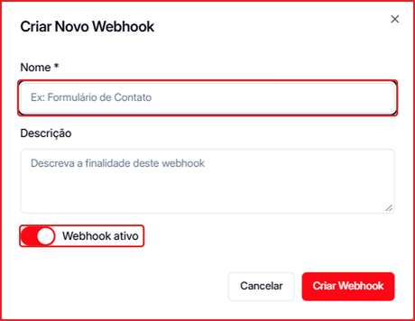
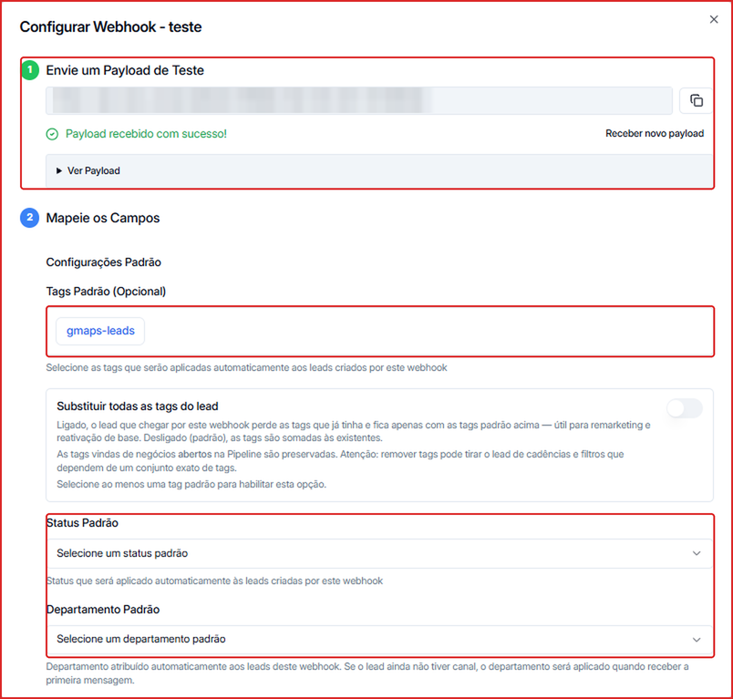
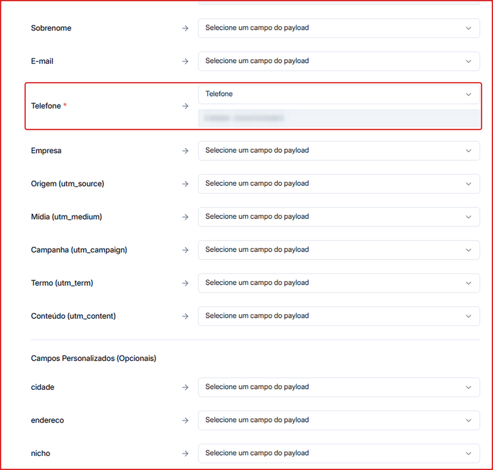
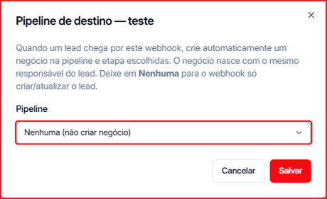
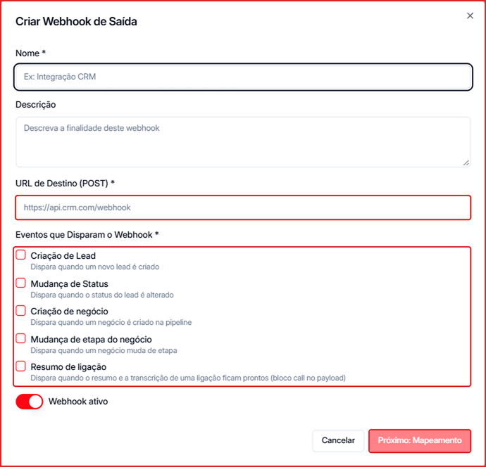

Com webhooks você liga a Leavo a praticamente qualquer sistema:

- **Entrada** — recebe contatos de formulários, landing pages, planilhas, automações (Zapier, Make, n8n) e outros sistemas.
- **Saída** — envia eventos da Leavo (novo contato, mudança de status, negócio criado ou movido, resumo de ligação) para o seu CRM ou outra ferramenta.

**Para acessar:** Menu lateral → Integrações → **Webhook**

---

## Webhook de entrada: receber contatos

### 1. Crie o webhook

1. Na aba **Entrada**, clique em **\+ Adicionar Webhook**.
2. Dê um **Nome** (ex.: "Formulário do site") e, se quiser, uma **Descrição**.
3. Deixe **Webhook ativo** ligado e clique em **Criar Webhook**.

O webhook aparece na lista com a **URL** gerada pela Leavo. Clique no ícone de copiar ao lado da URL e cole no sistema de origem (formulário, automação etc.) como destino do envio.

### 2. Envie um teste e mapeie os campos

1. Clique em **Editar Mapeamento**.
2. Em **Envie um Payload de Teste**, dispare um envio de teste a partir do sistema de origem. Quando chegar, aparece **Payload recebido com sucesso!** — clique em **Ver Payload** para conferir os dados. Use **Receber novo payload** para testar de novo.
3. Em **Mapeie os Campos**, defina as **Configurações Padrão** aplicadas a todo contato que chegar por esse webhook:
   - **Tags Padrão** — tags adicionadas automaticamente. Ligue **Substituir todas as tags do lead** se quiser que o contato fique só com essas tags (útil para remarketing e reativação de base).
   - **Status Padrão** — status aplicado ao contato.
   - **Departamento Padrão** — departamento responsável pelo contato.

4. Mais abaixo, ligue cada campo da Leavo ao campo correspondente do payload: Nome, Sobrenome, E-mail, **Telefone** (obrigatório), Empresa, UTMs (origem, mídia, campanha, termo, conteúdo) e os seus **Campos Personalizados**. Uma prévia mostra o valor que veio no teste.
5. Clique em **Salvar e Concluir**.

<Tip>
  Para campos aninhados no payload, use notação de ponto — por exemplo, `customer.name`.
</Tip>

### 3. Crie negócios no Pipeline automaticamente (opcional)

1. Clique em **Pipeline de destino** no webhook.
2. Escolha a **Pipeline** e a etapa onde o negócio deve nascer. O negócio já vem com o mesmo responsável do contato.
3. Clique em **Salvar**. Deixe **Nenhuma (não criar negócio)** para o webhook só criar ou atualizar o contato.

Na lista, cada webhook mostra o **Último disparo**. Use o toggle **Ativo** para pausar e a **lixeira** para excluir.

---

## Webhook de saída: enviar eventos da Leavo

1. Abra a aba **Saída** e clique em **\+ Adicionar Webhook** (ou **Criar Webhook de Saída**).
2. Preencha o **Nome**, a **Descrição** (opcional) e a **URL de Destino (POST)** — o endereço que vai receber os dados.
3. Marque os **Eventos que Disparam o Webhook**:
   - **Criação de Lead** — quando um novo contato é criado.
   - **Mudança de Status** — quando o status do contato muda.
   - **Criação de negócio** — quando um negócio é criado no Pipeline.
   - **Mudança de etapa do negócio** — quando um negócio muda de etapa.
   - **Resumo de ligação** — quando o resumo e a transcrição de uma ligação ficam prontos.
4. Clique em **Próximo: Mapeamento**, defina quais dados vão no envio e salve.

