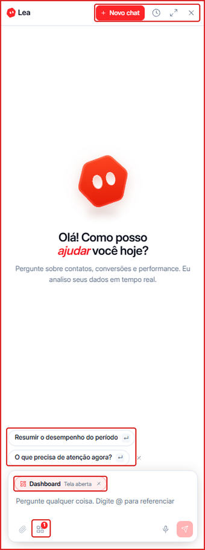
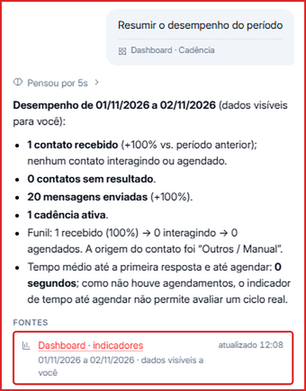
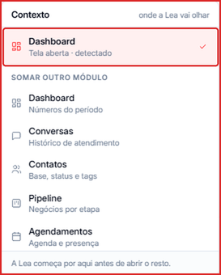
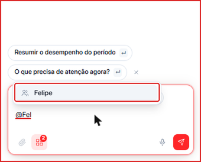
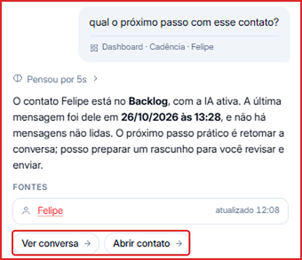
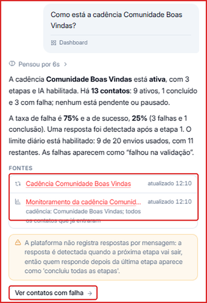
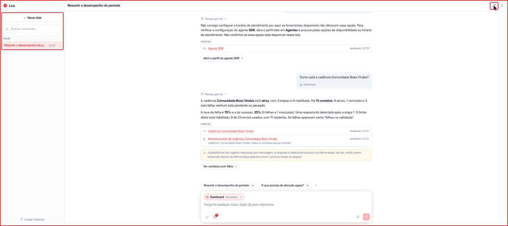

A **Lea** é a copiloto comercial da Leavo. Ela é uma IA que **consulta os dados da sua conta em tempo real** — contatos, conversas, cadências, pipeline, agendamentos e dashboard — e responde em linguagem simples, sempre mostrando de onde tirou a informação.

Use a Lea para:

- **Resumir resultados** do Dashboard e do período.
- **Resumir conversas e contatos** e saber em que pé está cada um.
- **Indicar o próximo passo** com um contato ou negócio.
- **Analisar cadências** — contatos ativos, concluídos, com falha e limite de envio.
- **Tirar dúvidas de configuração** e ir direto para a tela certa.

---

## Como abrir a Lea

Clique no botão **Lea**, no canto superior direito de qualquer tela da Leavo.

O painel da Lea abre à direita, sem tirar você da tela em que está.

- **\+ Novo chat** — começa uma conversa nova com a Lea.
- **Ícone de relógio** — abre o **Histórico** das suas conversas com a Lea.
- **Ícone de expandir** — abre a Lea em tela cheia.
- **Sugestões** — perguntas prontas, como **Resumir o desempenho do período** e **O que precisa de atenção agora?**. Clique para enviar.
- **Campo de mensagem** — escreva sua pergunta, anexe arquivos (clipe) ou fale pelo microfone.

---

## Como fazer uma pergunta

1. Abra a Lea.
2. Clique numa sugestão ou escreva sua pergunta em **Pergunte qualquer coisa**.
3. Pressione **Enter** ou clique no botão de enviar.

A Lea mostra quanto tempo pensou (ex.: **Pensou por 5s**), responde e lista as **Fontes** que consultou, com o horário da última atualização. Clique numa fonte para abrir a tela correspondente.

---

## Contexto: onde a Lea vai olhar

A Lea começa pela **tela que está aberta**. Ela aparece como uma etiqueta acima do campo de mensagem (ex.: **Dashboard · Tela aberta**).

Para a Lea considerar outros módulos na mesma pergunta:

1. Clique no **ícone de módulos** (quadradinhos) na barra de mensagem.
2. Em **Somar outro módulo**, escolha entre **Dashboard**, **Conversas**, **Contatos**, **Pipeline**, **Agendamentos**, **Campanhas**, **Cadência**, **Agentes** e **Conhecimento**.
3. Os módulos escolhidos aparecem como etiquetas. Clique no **x** para remover.

---

## Como perguntar sobre um contato ou negócio

Digite **@** no campo de mensagem e comece a escrever o nome. A Lea busca **contatos e negócios**; clique no resultado para referenciá-lo na pergunta.

Exemplo: _"@Felipe qual o próximo passo com esse contato?"_. A Lea diz em que etapa o contato está, quando foi a última mensagem e sugere o próximo passo. Abaixo da resposta aparecem atalhos como **Ver conversa** e **Abrir contato**.

---

## Exemplos do que perguntar

| Objetivo | Exemplo de pergunta |
| --- | --- |
| Resumo do período | "Resuma o desempenho deste mês" |
| Prioridades | "O que precisa de atenção agora?" |
| Próximo passo | "@Maria qual o próximo passo com esse contato?" |
| Resumo de conversa | "Resuma a conversa com @João" |
| Cadência | "Como está a cadência Boas Vindas?" |
| Pipeline | "Quantos negócios estão parados na etapa Proposta?" |
| Configuração | "Como configuro o horário de atendimento do meu agente?" |

### Exemplo: análise de cadência

A Lea traz o status da cadência, o total de contatos (ativos, concluídos e com falha), as taxas de sucesso e falha e o uso do limite diário, com as fontes consultadas e um atalho para agir (ex.: **Ver contatos com falha**).

<Note>
  Em dúvidas de configuração, a Lea explica onde fica a opção e mostra um atalho para a tela certa (ex.: **Abrir o perfil do agente**). A alteração em si você faz na própria tela.
</Note>

---

## Histórico e tela cheia

- Clique no **ícone de relógio** para ver o **Histórico**. Use **Buscar conversas** para encontrar uma conversa antiga e **Limpar histórico** para apagar todas.
- Clique no **ícone de expandir** para usar a Lea em tela cheia, com o histórico na lateral. Clique de novo para voltar ao painel.

---

## Dúvidas frequentes

<AccordionGroup>
  <Accordion title="A Lea vê dados de todo o time?">
    A Lea mostra os **dados visíveis para você**, de acordo com o seu [papel e permissões](/organizacao/papeis-e-permissoes).
  </Accordion>

  <Accordion title="Os dados da Lea são atualizados?">
    Sim. A Lea consulta a Leavo no momento da pergunta, e cada fonte mostra o horário da última atualização.
  </Accordion>

  <Accordion title="Qual a diferença entre a Lea e os agentes de IA?">
    Os [agentes](/agentes/visao-geral) conversam com os seus contatos no WhatsApp. A Lea conversa com **você e o seu time**, dentro da Leavo, para analisar dados e ajudar a decidir o que fazer.
  </Accordion>
</AccordionGroup>
