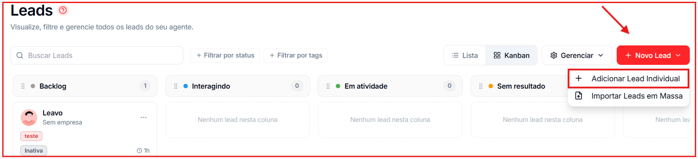
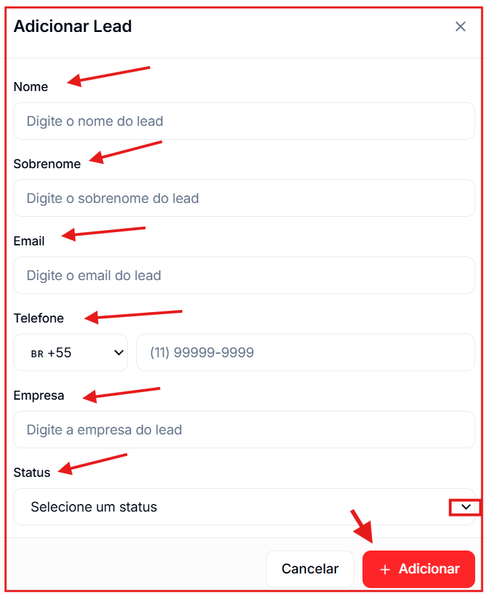
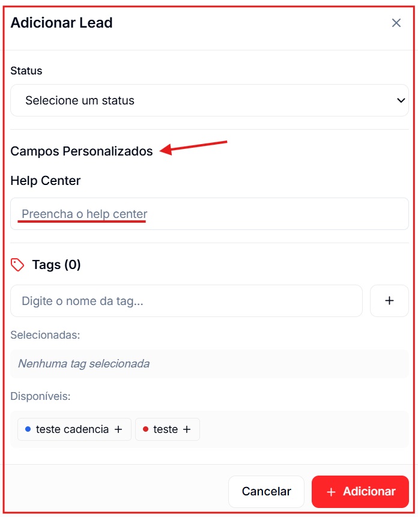
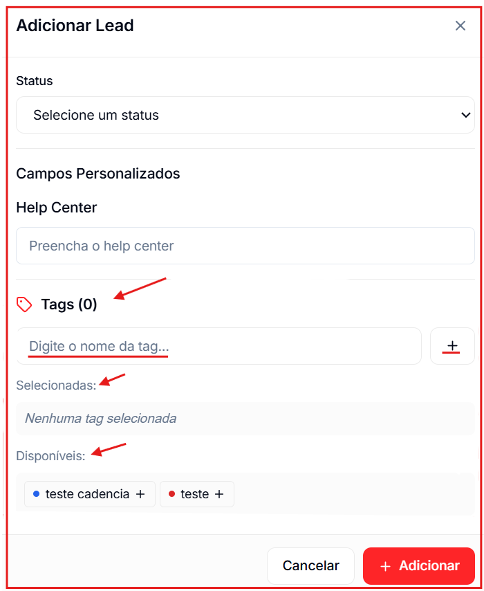

🎥 **Prefere assistir?** Veja o tutorial em vídeo:

<iframe className="w-full aspect-video rounded-xl border border-gray-200 dark:border-gray-800" src="https://www.tella.tv/video/como-adicionar-novos-leads-de-forma-individual-askv/embed" allowFullScreen />

---

# Como adicionar

Para adicionar um contato manualmente, clique na seta de **\+ Novo Contato**, no canto superior direito da tela **Contatos**, e selecione **Adicionar Contato Individual**.

## Campos do formulário

**Nome** _(obrigatório)_ Primeiro nome do contato.

**Sobrenome** Sobrenome do contato.

**Email** Endereço de e-mail do contato.

**Telefone** Selecione o código do país (padrão: BR \+55; números internacionais são aceitos) e insira o número. Exemplo: `(11) 99999-9999`.

**Empresa** Nome da empresa do contato.

**Status** Selecione a etapa inicial do contato no funil (ex: Backlog, Interagindo). Se não selecionado, o status padrão é aplicado automaticamente.

## Campos Personalizados

Abaixo dos campos padrão, aparecem os **campos personalizados** configurados pela sua conta em **Gerenciar → Campos**. Preencha os que forem relevantes para este contato.

## Tags

Na seção **Tags**, você pode aplicar tags ao contato no momento do cadastro:

- Digite o nome da tag no campo de busca para encontrar uma existente.
- Clique em uma tag disponível para selecioná-la (ela aparece em "Selecionadas").
- Para remover, clique novamente na tag selecionada.

Ao terminar, clique em **\+ Adicionar** para salvar o contato.
