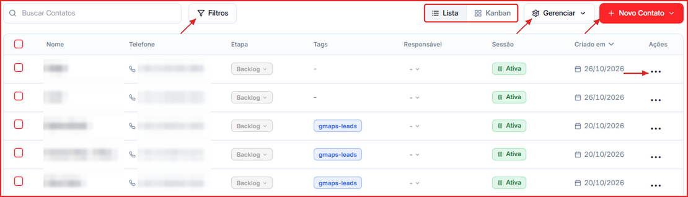
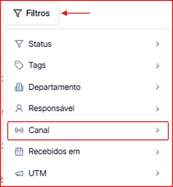
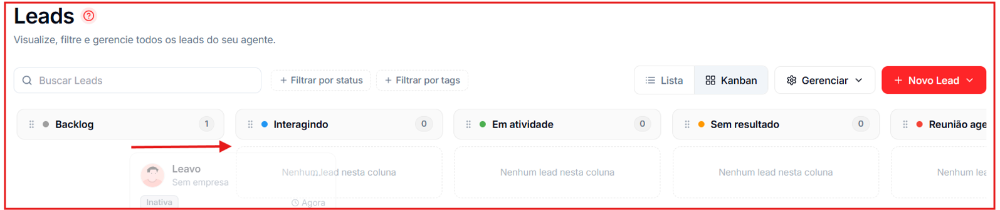

A tela **Contatos** (antiga tela de Leads) mostra todos os contatos da sua base, com dois modos de visualização: **Lista** e **Kanban**.

**Para acessar:** Menu lateral → Contatos

🎥 **Prefere assistir?** Veja o tutorial em vídeo:

<iframe className="w-full aspect-video rounded-xl border border-gray-200 dark:border-gray-800" src="https://www.tella.tv/video/leads-lista-e-kanban-0wp3/embed" allowFullScreen />

---

## Como buscar um contato

Digite o nome ou o telefone no campo **Buscar Contatos**. A lista é filtrada enquanto você digita.

---

## Como filtrar contatos

Clique em **Filtros** e escolha um ou mais critérios:

| Filtro | Use para |
| --- | --- |
| **Status** | Ver contatos em uma etapa (Em atividade, Interagindo, Sem resultado, Backlog, Reunião agendada) |
| **Tags** | Ver contatos com determinadas tags |
| **Departamento** | Ver contatos de um departamento |
| **Responsável** | Ver contatos de um membro do time |
| **Canal** | Ver contatos atribuídos a um número de WhatsApp específico |
| **Recebidos em** | Ver contatos que chegaram em um período |
| **UTM** | Ver contatos por origem de campanha (utm_source, utm_campaign etc.) |

Os filtros podem ser combinados.

---

## Como alternar entre Lista e Kanban

Clique em **Lista** ou **Kanban** no topo da tela. No **Kanban**, cada coluna é um status; para mudar o status de um contato, arraste o card para a coluna de destino.

---

## Como adicionar contatos

Clique na seta de **\+ Novo Contato** e escolha:

- **Adicionar Contato Individual** — veja [Adicionar contato individual](/leads/adicionar-individual).
- **Importar Contatos em Massa** — veja [Importar em massa](/leads/importar-em-massa).

---

## Como gerenciar tags, status e campos

Clique em **Gerenciar** e escolha **Tags**, **Status** ou **Campos** para criar e editar essas opções. Veja [Gerenciar tags, status e campos](/leads/gerenciar-tags-status-campos).

---

## Como abrir o perfil de um contato

Na **Lista**, clique no nome do contato. Um painel lateral abre com **Contato**, **Campos Personalizados**, **Atendimento**, **Tags** e **Resumo da conversa**. Veja [Perfil do contato](/leads/perfil-do-lead).

---

## Como alterar o status direto na lista

Na coluna **Etapa**, clique no status atual e selecione o novo. A mudança é aplicada na hora.

---

## Ações em massa e exportação

Marque a caixa de seleção de um ou mais contatos (ou a do cabeçalho, para selecionar todos) para abrir as ações em massa: aplicar tags, trocar status, criar negócios no Pipeline, excluir ou **exportar** a lista. Na exportação, você escolhe quais colunas e **campos personalizados** entram no arquivo.

---

## O que cada coluna significa

| Coluna | O que exibe |
| --- | --- |
| Nome | Nome do contato |
| Telefone | Número do contato (inclusive internacionais) |
| Etapa | Status atual, com troca rápida |
| Tags | Tags aplicadas |
| Responsável | Membro do time responsável pelo contato |
| Sessão | Estado do agente para o contato (Ativa, Inativa ou Pausada) |
| Criado em | Data de cadastro |
| Ações | Menu `...` com ações rápidas |
