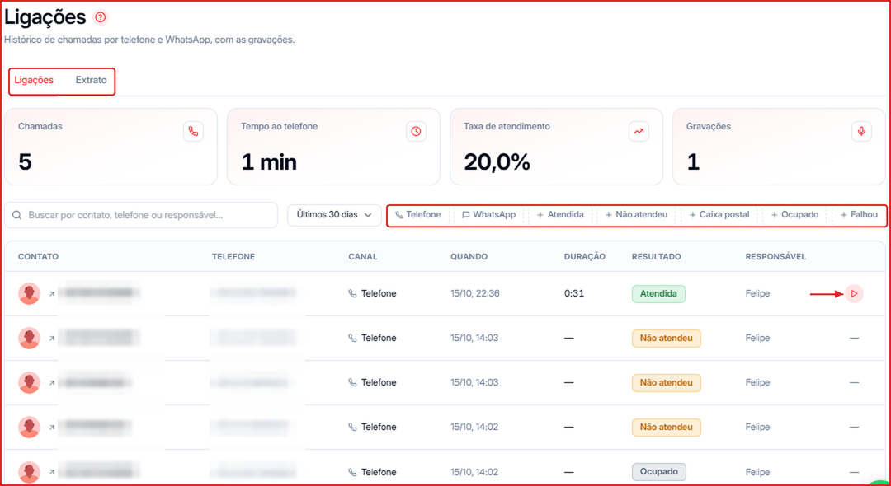
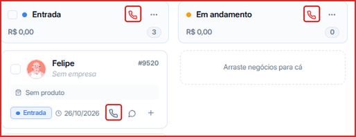
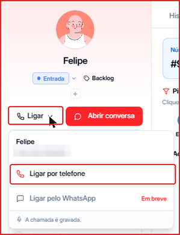
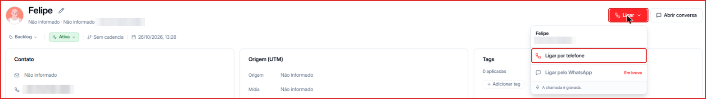

A tela **Ligações** reúne o histórico de chamadas feitas pela Leavo, com as gravações, e o extrato dos seus minutos de telefonia.

**Para acessar:** Menu lateral → Ligações

---

## Como fazer uma ligação

Você pode ligar para um contato pelo **Pipeline** ou pelos **detalhes do contato**. Toda chamada é **gravada** e aparece depois nesta tela, com a gravação.

<Note>
  Hoje as ligações são feitas **por telefone** (fixo e celular) e consomem [Créditos de Telefonia](/creditos/creditos-telefonia). A opção **Ligar pelo WhatsApp** aparece no menu como **Em breve**.
</Note>

### Pelo Pipeline

- **No card do negócio:** clique no **ícone de telefone** no rodapé do card para ligar para o contato daquele negócio.
- **No cabeçalho da etapa:** clique no **ícone de telefone vermelho** ao lado do nome da etapa para **discar a etapa** — a Leavo liga em sequência para os contatos dos negócios daquela etapa.
- **Dentro do negócio:**

  1. Clique no card para abrir o painel do negócio.
  2. Clique em **Ligar**. O menu mostra o nome e o telefone do contato.
  3. Clique em **Ligar por telefone** para iniciar a chamada.

### Pelos detalhes do contato

1. Acesse **Menu lateral → Contatos** e abra o contato (clique em `...` → **Abrir**, ou no nome dele).
2. No canto superior direito, clique no botão vermelho **Ligar**.
3. Clique em **Ligar por telefone**.

<Tip>
  Ao lado do **Ligar** fica o botão **Abrir conversa**, para falar com o mesmo contato pelo WhatsApp.
</Tip>

---

## Aba Ligações

No topo ficam os indicadores do período: **Chamadas**, **Tempo ao telefone**, **Taxa de atendimento** e **Gravações**.

Abaixo, a lista mostra cada chamada com contato, telefone, canal, data, duração, resultado e responsável.

- Use a **busca** para encontrar por contato, telefone ou responsável.
- Filtre pelo **período** (ex.: Últimos 30 dias), pelo **canal** (**Telefone** ou **WhatsApp**) e pelo **resultado**: **Atendida**, **Não atendeu**, **Caixa postal**, **Ocupado** ou **Falhou**.
- Clique no botão ▶ para ouvir a **gravação** de uma chamada atendida.

<Tip>
  O resumo e a transcrição das ligações também aparecem no resumo do negócio no Pipeline e podem ser enviados para outros sistemas por [Webhook](/integracoes/visao-geral).
</Tip>

---

## Aba Extrato

Mostra as **compras de minutos** e todas as **movimentações** do seu saldo de telefonia: reservas para ligação, consumo, liberações e ajustes, com o saldo após cada movimentação.

---

## Minutos de telefonia

As ligações consomem os **Créditos de Telefonia** (em minutos). Para ver o saldo, clique no seu nome no canto inferior esquerdo — o card **Créditos de Telefonia** mostra os minutos disponíveis e usados. Ligações pelo WhatsApp não consomem minutos. Para comprar mais minutos (R\$ 0,60/min, válidos por 12 meses), veja [Créditos de Telefonia](/creditos/creditos-telefonia).

No [Dashboard](/dashboard), a aba **Ligações** traz os números consolidados do time, como melhor hora para ligar e performance por pessoa.
