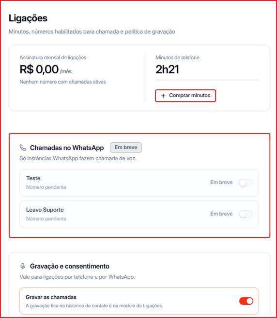
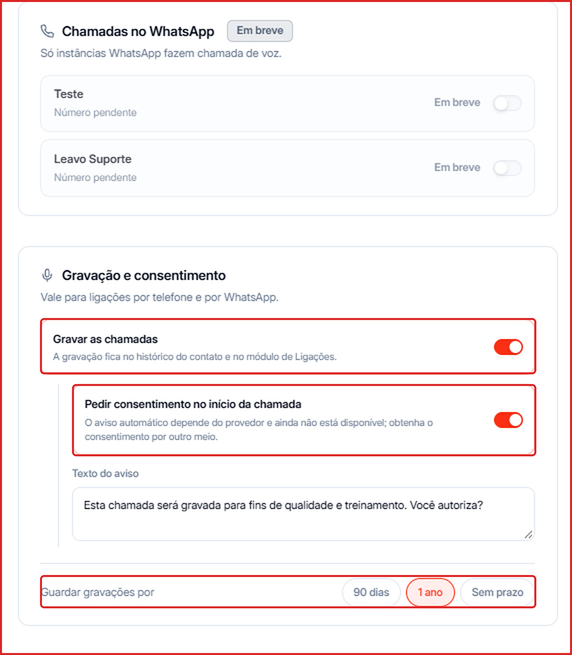

Nas configurações de Ligações você acompanha a assinatura e os minutos de telefone e define como as chamadas são gravadas.

**Para acessar:** clique no seu nome no canto inferior esquerdo → **Ligações**

---

## Assinatura e minutos

- **Assinatura mensal de ligações** — o valor mensal do recurso de ligações na sua conta.
- **Minutos de telefone** — o saldo de minutos para ligar para fixo e celular. Clique em **Comprar minutos** para adicionar mais. Veja [Créditos de Telefonia](/creditos/creditos-telefonia).
- **Chamadas no WhatsApp** — ligações pelo próprio WhatsApp, configuradas por canal. Esse recurso aparece como **Em breve**.

---

## Gravação e consentimento

1. **Gravar as chamadas** — liga ou desliga a gravação das ligações. Com a gravação ligada, você ouve as chamadas na tela [Ligações](/ligacoes).
2. **Pedir consentimento no início da chamada** — avisa o contato de que a ligação está sendo gravada. O aviso automático depende do provedor de telefonia e ainda não está disponível.
3. **Texto do aviso** — o texto que será usado no aviso de gravação.
4. **Guardar gravações por** — escolha por quanto tempo as gravações ficam disponíveis: **90 dias**, **1 ano** ou **Sem prazo**.

<Tip>
  Se o seu negócio precisa seguir a LGPD com rigor, defina um prazo de armazenamento e informe o contato sobre a gravação no início da conversa.
</Tip>
