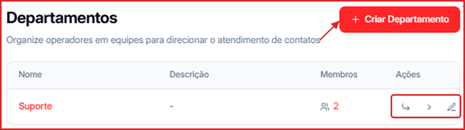
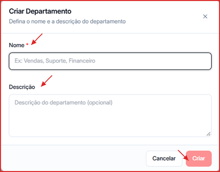
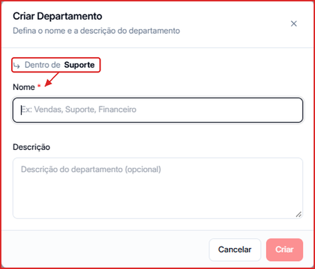

Departamentos permitem agrupar operadores por equipe ou função, facilitando o roteamento de conversas e o controle de visibilidade de leads. A estrutura suporta **sub-departamentos**, permitindo hierarquias como Vendas → SDR, Closer, Pós-venda.

Acesse clicando no seu nome de usuário no **canto inferior esquerdo** e selecionando **Departamentos**.

---

## Criar um departamento

1. Clique no botão **\+ Criar Departamento** no canto superior direito
2. Informe o **Nome** do departamento (obrigatório) — ex.: Vendas, Suporte, Financeiro
3. Adicione uma **Descrição** opcional para identificar a função do time
4. Clique em **Criar**

O departamento aparece na lista com o número de membros e as ações disponíveis.

---

## Criar sub-departamentos

Sub-departamentos permitem criar hierarquias dentro de um departamento principal — por exemplo, um departamento **Vendas** com sub-departamentos **SDR**, **Closer** e **Pós-venda**.

Para criar um sub-departamento:

1. Na lista de departamentos, localize o departamento pai
2. Clique no ícone de **sub-departamento** (↳) na coluna Ações
3. Uma janela "Criar Departamento" abrirá com a indicação **Dentro de [nome do pai]**
4. Informe o nome e descrição do sub-departamento e clique em **Criar**

## Mover um departamento

Clique no ícone **\>** na linha do departamento para abrir **Mover departamento**. Escolha em **Mover para dentro de** o novo departamento pai — ou **Nenhum** para torná-lo um departamento raiz — e clique em **Mover**. Os sub-departamentos vão junto. Destinos que criariam ciclos ou passariam do limite de níveis não aparecem na lista.

---

## Gerenciar membros

Cada departamento tem uma lista de **operadores** que pertencem a ele. Para adicionar membros:

1. Clique no ícone de **editar** (✏️) ao lado do departamento
2. Na tela "Editar Departamento", a seção **Membros** lista os operadores disponíveis
3. Selecione os operadores que devem pertencer ao time e clique em **Salvar**

<Note>
  Para aparecer como opção de membro, o operador precisa ter sido convidado previamente em **Organização**. Sem convite, a lista de membros disponíveis ficará vazia.
</Note>

A coluna **Membros** na listagem mostra o total de operadores em cada departamento.

---

## Ações disponíveis por departamento

Cada linha da lista de departamentos exibe quatro ações na coluna **Ações**:

| Ícone | Função |
| --- | --- |
| 👥 (contador) | Visualiza o total de membros no departamento |
| ↳ | Cria um sub-departamento dentro deste departamento |
| \> | Move o departamento para dentro de outro (ou para a raiz) |
| ✏️ | Edita nome, descrição e membros do departamento |

---

## Para que servem os departamentos?

- **Segmentar equipes**: cada operador atende apenas os contatos do seu departamento
- **Roteamento de conversas**: cada canal pode ter um departamento responsável, e a [Distribuição de contatos](/canais/configurar-canal) reparte os novos contatos entre os membros da equipe
- **Estrutura hierárquica**: organizar times complexos com sub-departamentos (ex.: Vendas → SDR, Closer)
- **Métricas por time**: acompanhar performance separada por departamento no dashboard

<Tip>
  Ao convidar um novo membro em **Organização**, você pode atribuí-lo a um departamento diretamente no formulário de convite.
</Tip>
