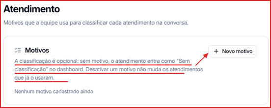

Os **Motivos de atendimento** são as categorias que o seu time usa para classificar cada atendimento — por exemplo, _Dúvida sobre preço_, _Suporte técnico_ ou _Agendamento_. Eles alimentam o bloco **Por que procuram você** na aba **Atendimento** do [Dashboard](/dashboard).

**Para acessar:** clique no seu nome, no canto inferior esquerdo → **Atendimento**

---

## Como criar um motivo

1. Clique no seu nome, no canto inferior esquerdo, e depois em **Atendimento**.
2. Na seção **Motivos**, clique em **\+ Novo motivo**.
3. Dê um nome ao motivo e salve.

---

## Como funciona a classificação

- Classificar é **opcional**. Atendimentos sem motivo aparecem como **Sem classificação** no Dashboard.
- **Desativar** um motivo não altera os atendimentos que já foram classificados com ele.

<Tip>
  Mantenha uma lista curta e clara de motivos — assim fica fácil para o time classificar e o relatório de **Por que procuram você** fica mais útil.
</Tip>
