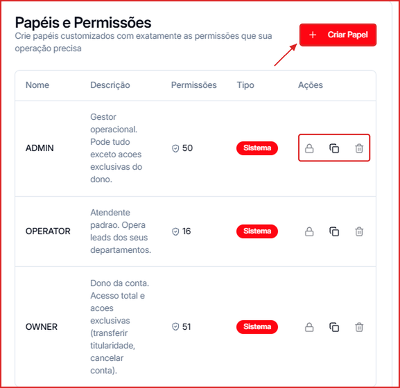
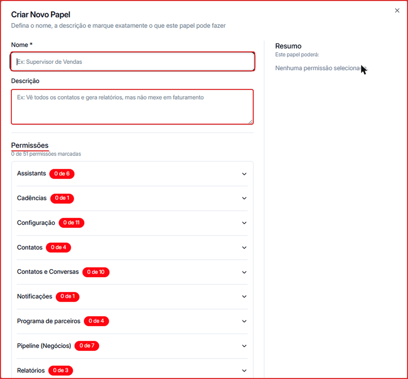
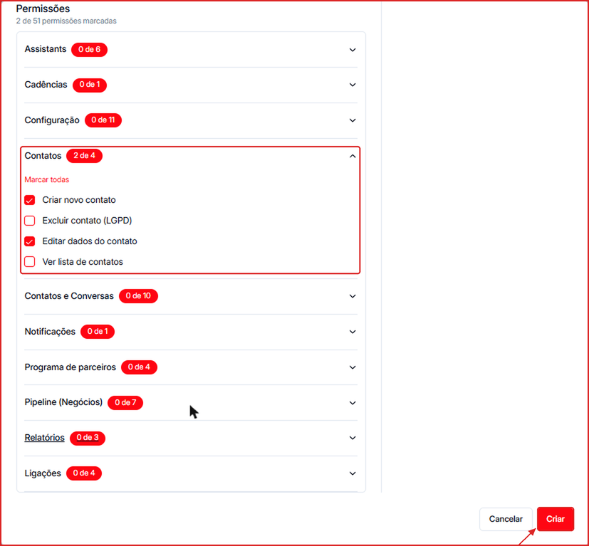

A Leavo permite criar papéis com permissões específicas para diferentes perfis de usuário dentro da sua organização.

Acesse clicando no seu nome de usuário no **canto inferior esquerdo** e selecionando **Papéis e Permissões**.

---

## Papéis padrão do sistema

A plataforma inclui três papéis de sistema que não podem ser excluídos:

| Papel | Descrição | Permissões |
|-------|-----------|------------|
| **OWNER** | Dono da conta. Acesso total e ações exclusivas (transferir titularidade, cancelar conta). | 51 |
| **ADMIN** | Gestor operacional. Pode tudo, exceto as ações exclusivas do dono. | 50 |
| **OPERATOR** | Atendente padrão. Opera os contatos dos seus departamentos. | 16 |

Na coluna **Ações** de cada papel você encontra o cadeado (papel de sistema, bloqueado para edição), **Duplicar** e **Excluir**.

---

## Criar um papel customizado

1. Clique em **\+ Criar Papel**.
2. Preencha o **Nome** (ex.: "Supervisor de Vendas") e, se quiser, uma **Descrição** do que o papel pode fazer.

3. Em **Permissões**, abra cada grupo e marque o que o papel pode fazer. Use **Marcar todas** para liberar o grupo inteiro. Os grupos são: Assistants, Cadências, Configuração, Contatos, Contatos e Conversas, Notificações, Programa de parceiros, Pipeline (Negócios), Relatórios e Ligações.
4. Ao lado de cada grupo aparece quantas permissões estão marcadas (ex.: **2 de 4**), e o painel **Resumo** mostra tudo o que o papel poderá fazer.
5. Clique em **Criar**.

Papéis customizados podem ser duplicados, editados e excluídos conforme necessário.

<Tip>
  Para começar a partir de um papel existente, clique em **Duplicar** na linha dele e ajuste as permissões da cópia.
</Tip>

---

## Atribuir um papel a um usuário

O papel é definido no momento do convite (em **Organização → Convidar por e-mail**). Para alterar o papel de um membro existente, acesse a lista de membros do seu workspace.

<Note>
  Papéis de sistema (**OWNER**, **ADMIN**, **OPERATOR**) são bloqueados para edição, mas podem ser usados como base para duplicar e criar papéis customizados.
</Note>
