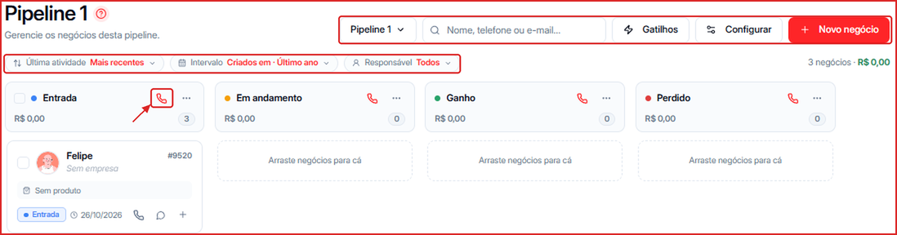
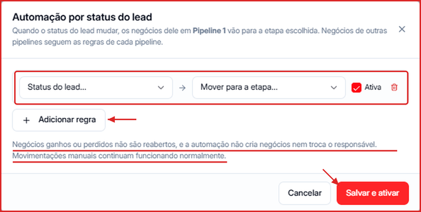
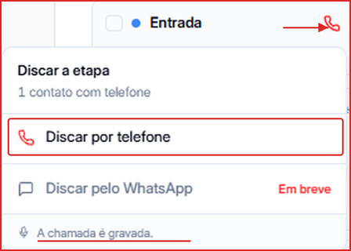

O quadro do **Pipeline** mostra seus negócios em colunas, uma para cada etapa do funil.

**Para acessar:** Menu lateral → Pipeline

---

## Como alternar entre pipelines

Clique no **seletor de pipeline** (ex.: **Pipeline 1**), no topo, e escolha a pipeline desejada.

---

## Como buscar e filtrar negócios

- **Busca** — encontre negócios pelo **nome, telefone ou e-mail** do contato.
- **Última atividade** — ordene por mais recentes ou mais antigos.
- **Intervalo** — filtre pelo período de criação ou de atualização (ex.: Último ano).
- **Responsável** — veja só os negócios de um membro do time.

No canto direito aparece o total de negócios e a soma dos valores filtrados.

---

## Como mover um negócio de etapa

Arraste o card para a coluna de destino. Você também pode abrir o card e alterar a etapa no painel do negócio. Para mover para **outra pipeline**, abra o negócio e escolha a nova pipeline e etapa.

---

## Como automatizar a etapa pelo status do contato (Gatilhos)

Com os **Gatilhos**, sempre que o status de um contato mudar, os negócios dele nesta pipeline vão automaticamente para a etapa que você escolher.

1. Clique em **Gatilhos**.
2. Clique em **\+ Adicionar regra**.
3. Em **Status do lead**, escolha o status que dispara a regra (ex.: Reunião agendada).
4. Em **Mover para a etapa**, escolha a etapa de destino.
5. Deixe a caixa **Ativa** marcada e clique em **Salvar e ativar**.

<Note>
  Negócios ganhos ou perdidos não são reabertos, e a automação não cria negócios nem troca o responsável. Movimentações manuais continuam funcionando normalmente. Cada pipeline tem suas próprias regras.
</Note>

---

## Como ligar para os contatos de uma etapa

Clique no **ícone de telefone** no cabeçalho de uma coluna para abrir **Discar a etapa**. A Leavo mostra quantos contatos da etapa têm telefone; clique em **Discar por telefone** para começar as ligações. As chamadas são gravadas e ficam disponíveis em [Ligações](/ligacoes).

<Note>
  A discagem pelo WhatsApp aparece como **Em breve**. As ligações consomem minutos dos **Créditos de Telefonia**.
</Note>

---

## Como abrir a conversa ou ligar para um contato

No card do negócio, use os ícones de **telefone** (ligar), **balão** (abrir a conversa) e **\+** (ações rápidas).

---

## O que cada card exibe

Nome do contato, empresa, número do negócio (ex.: #9520), produto, valor, etapa e data. O **resumo do negócio** também traz o resumo das ligações feitas com o contato.
